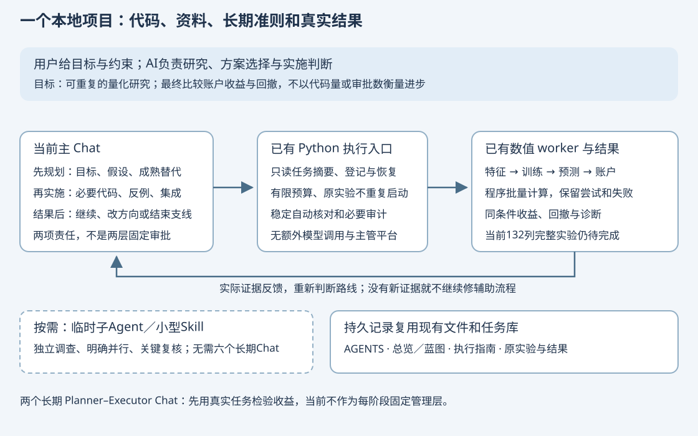

# 接下来怎样用 Codex 建设这个项目

2026-10-12。本文结合当前代码、用户贴出的完整交接稿、截图和已读官方资料，更新项目的施工方式。原生 read_thread 接口当前不可调用；引用 Chat 的内容由用户提供，不能说成已经直接读取该 Chat。交接中的旧代码规模、历史模型配置和额度消耗，分别按“原报告记录”和“用户描述”处理。

**推荐：同一个本地项目，当前成果由一个主 Chat 负责持续规划和实施；独立调查与必要复核按需委派；重复数值工作由现有 Python 程序执行。** 两个长期 Planner–Executor Chat 是可以检验的替代路线，现阶段不先增加一层固定管理。

这里的关键改变是：主 Chat 必须不断判断“这项工作是否仍值得做、原假设是否成立、有没有成本更低的成熟方法”。它不能只负责把旧计划执行到底。

## 1. 用一个例子说明整个工作过程

现在的问题不是“把64个公式跑完”。真正要回答的是：**在我们已有数据上，增加这些信息，能否使模型选股的账户收益更高，或在相近收益下回撤更小？**

主 Chat 先检查原68列数据、新增64列结果和已登记任务。发现某周未来收益尚未结束，就先修共同可比较日期；不能让“那周没有选股、因此保持现金”的公式占便宜。新增列也不需要各自单独选股赚钱才能进入多变量模型。

Python 负责计算可用特征、训练已选模型、保存预测、运行账户和输出数字。主 Chat 读有限的摘要，再判断：是新信息没有帮助，还是覆盖率变化造成区别？是否应该换模型、调整问题，或停止这条支线？

这才是“上层规划 → 实施 → 结果反馈 → 重新规划”。它可以先在一个主 Chat 中实现；仅给同一个模型换一个“主管”称呼，并不会增加独立性。

## 2. 交接中的事实，哪些已核实，哪些不能直接当成现状

| 交接描述 | 现有依据与边界 | 现在怎么处理 |
|---|---|---|
| 旧流程固定两名复核者、时间窗口和AI裁决 | 旧总控和旧规划确实保留这些规则；旧正文与新入口存在冲突 | 日常执行已由新的 ExecutionPlans 接管；本轮修正活动文档，旧V7仅兼容使用 |
| 反复恢复、登记、归档辅助脚本膨胀 | 上轮清单核对并归档1307份旧阶段脚本，38份保守保留；不是全部永久删除 | 默认入口不再生成逐阶段脚本，冻结历史不改 |
| 文件核对和复核纠缠，重复读取大量记录 | 旧方案与成本复盘记有这些情况；没有完整可用的桌面Token计量 | 数值审计按内容绑定复用；本轮增加只读任务摘要，完整历史按需查 |
| 64列单独筛选比较的最后一周不公平 | 已有成熟日期问题报告说明56项与8项被不同处理，原选中1项不能支持特征优劣结论 | 对应工程任务保留；共同成熟条件与缺失原因需要修复和反例，不把它包装成收益发现 |
| 24小时用掉几乎一周额度、历史采用某模型/强度 | 这是用户观察和交接描述；本轮没有账户用量接口或原配置记录 | 不编造Token占比、节省百分比或精确计费 |
| 278份代码、1345份辅助脚本及行数 | 是以前报告的特定口径，不等于24小时新增工作量 | 不为再次确认行数耗费整轮资源；成果以可运行能力及研究证据判断 |

上轮执行重构已经实际交付，源码提交 e23f5d6 的 Windows/Ubuntu CI 均通过；详见[重构结果](EXECUTION_REFACTOR_RESULTS_20261012.html)。这只能证明已验证的工程行为，不能证明132列模型或收益已经成功。本轮的新摘要代码另有验证记录。

新审计缓存仍保守地绑定较大源码范围，不是已经实现函数级依赖追踪。执行计划支持准备好的提案与实验引用；动态训练、预测、账户的下一提案还需要具体适配，不能声称已有全自动研究主管。

## 3. 为什么旧系统能持续做低价值工作

根因是把“流程允许进入下一步”变成了当前目标，而没有及时重新判断流程是否必要。一旦辅助脚本失败，最直接的动作是修它；脚本变化又影响旧绑定，继而复核、冻结和归档。每次局部动作都能解释，整个链条却没有证明研究价值。

文件哈希证明某份内容是否改变，测试证明覆盖的行为，Agent意见提供审查角度。三者都不能单独证明研究设计正确。方法错误可能同时进入实现、测试和两名复核者的前提。

所以新的做法必须同时保留两件事：稳定的自动检查，以及阶段结果出来后的方向判断。不能靠增加监督人数替代独立的日期反例、手算账户和公平对照，也不能为了减少开销取消会影响结论的验证。

## 4. 三条路线比较，我们选择什么

| 路线 | 优点 | 成本与限制 | 当前选择 |
|---|---|---|---|
| 单主 Chat：持续规划＋实施 | 现状和目标在同一工作流，减少转述与协调 | 同一上下文可能强化旧假设；自身规划不是独立复核 | 默认。用真实结果纠偏，重要问题按需引入独立角度 |
| 两个长期 Chat：Planner–Executor | 上层可专注路线，实施者专注工程；适合长期独立并行 | 传递摘要、等待、重复读文件；上层也可能假设错误 | 保留候选。先在一个有实际价值的阶段验证收益，不先造消息总线 |
| 主 Chat＋现有子Agent／Skills | 独立搜索、限定审查或不同模块可并行；流程知识可复用 | 额外模型与上下文成本；角色数量不保证质量 | 按需使用，作为默认路线的补充 |

推荐来自当前需求、已经发生的流程负担和现有能力，不是证明“一个Chat永远最强”。另一个高级AI可以参与规划，但应拿实际减少的返工、发现的关键遗漏与交付质量证明作用；没有必要先把它变成固定审批者。

Anthropic 的长期开发实践先采用多层结构，后来按组件移除多余阶段；是否保留评估者取决于任务是否超过模型可靠完成的能力。这支持逐项验证管理机制的价值，不能把其网页开发实验的成本或成功率套到本项目。[长期开发实践](https://www.anthropic.com/engineering/harness-design-long-running-apps)

Aider 的 Architect/Editor 展示了设计与修改分工的可行方式；它的旧模型基准不能证明今天的 Codex 需要两个长期 Chat。[Aider实践](https://aider.chat/2024/09/26/architect.html)

## 5. “项目”、Chat和子Agent究竟是什么

截图中的项目显示名与真实代码目录是两件事。我们实际目录为 D:\Projects\a-share-quant-research-platform。不能仅凭截图认定旧标题的Chat当前在哪个目录，也不能把五条旧Chat自动当作五个研发角色。

本地项目提供相关代码和资料；每条Chat保留自己的对话记录。共享项目不等于每次回答必然读取所有历史Chat。持久规则、状态和证据继续保存在仓库与原任务库。[官方项目说明](https://learn.chatgpt.com/docs/projects)

当前就在本Chat继续当前成果。将来一个需要独立跟进的结果，可以另开Chat；同一个结果的训练、测试、修复和解释通常接着做。历史长或任务明显转换时，可以用简短交接开始新Chat，不规定每阶段强制重置，也不要求一个Chat永远承载整个项目。

临时子Agent由主Chat委派明确问题，结果返回主Chat。应用可能显示其活动或子线程；这不等于建立六个用户长期管理的Chat。它也消耗模型与工具资源，只在独立调查、真实并行或必要复核带来收益时使用。[官方子Agent说明](https://learn.chatgpt.com/docs/agent-configuration/subagents)

两个Chat需要同时改代码时，才考虑Git worktree或严格划分文件。worktree是独立代码副本；本机忽略的数据和尚未发布源码不会自动跟随。共享研究库必须显式指定，禁止两条工作流重复登记同一实验。[官方worktree说明](https://learn.chatgpt.com/docs/environments/git-worktrees)

本轮没有创建、改名、归档侧边栏Chat，也没有修改应用配置。界面显示名“A股量化研究平台”和Chat名称“主线建设与研究”只是整理建议。

## 6. 让规划持续发生，但不新增审批系统

复杂新方向或跨模块改动开始前，主Chat简短写清：
- 最终目标与不能违反的约束。
- 目前采用的假设，哪些尚无证据。
- 成熟替代办法及采用／不采用理由。
- 最小可失败试验、预期产物和有限预算。

这是一段有用的决策说明，不是每次文件修改都填写的表格。小修复可直接推进。

阶段结果到达、发现影响结论的错误、同类失败两次仍无新证据，或管理工作开始占据主要工作时，重新判断：继续、换方法、缩小问题，还是结束支线？下一步必须说明它将减少什么不确定性；不能只写“继续原计划”。

执行者可以反对规划。如果数据不支持、接口不成立或验收不能区分对错，就用证据反馈。主Chat也应改变自己的判断，不能把用户未经验证的做法换成一个不可质疑的主管假设。

已有任务的冻结规格和预算保持不变。判断需要变更范围时，沿用现有有父链的任务机制；没有改变范围，就继续原实验，不因新Chat、改报告或換角色重置尝试。

多Agent失败研究发现设计、代理协作和验证都有失效模式；多轮对话研究提示早期假设可能被反复强化。它们基于特定旧模型与实验条件，是风险提示，不能直接诊断本项目24小时运行或量化当前模型表现。[多Agent失效研究](https://arxiv.org/html/2503.13657)、[多轮对话研究](https://arxiv.org/html/2505.06120v1)

可靠外部反馈比只要求模型“再想一遍”更有用。这里优先使用独立反例、真实产物和账户复算，再按风险安排复核。[自我纠错综述](https://aclanthology.org/2024.tacl-1.78/)

## 7. 长期记忆、规则和Skills怎样安排

| 内容 | 放在哪里 | 何时读 |
|---|---|---|
| 短入场规则、权限和质量要求 | 根AGENTS.md | 开始工作 |
| 当前进度、下一步和全部工作包 | PROJECT_MAP、建设记录、原任务库 | 续跑先看摘要 |
| 最终目标、广度、成熟方案候选 | PROJECT_CHARTER、RESEARCH_RADAR、蓝图 | 选择新方向或重新规划 |
| 具体操作与接口 | EXECUTION_GUIDE、WORKER_GUIDE、DATA_CONTRACT | 涉及该操作时 |
| 冻结实验、失败、模型和账户 | 原research.sqlite3及原产物目录 | 需要核查时 |

不再新建“聊天记忆数据库”或另一个主管状态库。AGENTS是仓库指令，不能冒充系统指令；Skill是可复用操作知识，不能仅因有它就声称已运行一个主管Agent。[官方AGENTS说明](https://learn.chatgpt.com/docs/agent-configuration/agents-md)

有稳定、重复的操作且现有指南仍不足时，才做小型Skill；不先把每个职责包装成一个Skill。现有量化代码不会通过Skill自动变成成熟研究结论。

## 8. 模型与思考强度怎样选择

下面说的是**帮助写代码的Codex模型**，不是用于预测股票的Ridge、树或MLP。可选项以账户与客户端实际显示为准，本轮没有变更模型设置。

| 工作 | 建议起点 | 升级依据 |
|---|---|---|
| 日常实施、限定调试与测试 | GPT-6.1 Sol，默认或Medium | 复杂接口、关键时间／账户风险才提高强度 |
| 跨模块设计、重要研究方法判断 | Sol较高强度；必要时考虑Astra | 原模型遗漏关键假设或需要更深入方案比较 |
| 清晰的小修改和提取 | Luna较低强度，或沿用当前模型 | 以实际正确率及返工决定；微小工作无需额外切换 |
| 公式计算、固定核对、已有测试 | Python和现有worker | 不调用另一个模型阅读重复成功日志 |

官方当前区分Sol的工程适用范围、Luna的集中小任务和Astra的更困难工作；强度需要按任务调节。Max增加单项推理，Ultra适合有实质并行价值的复杂工作，不成为每项工作的固定设置。[模型说明](https://learn.chatgpt.com/docs/models)、[选择建议](https://learn.chatgpt.com/docs/model-selection)

历史上使用xhigh不证明方向正确；改成Medium也不保证更好。先比较少量实际任务的关键遗漏、返工和总完成时间，不为模型选型重复训练整套行情。不能把API价格换算成Pro剩余额度，也不承诺自动感知五小时重置。

## 9. 接下来真实施工顺序

| 次序 | 工作 | 能验证什么 |
|---|---|---|
| 本轮：纠正施工方式 | 更新本文、AGENTS和冲突正文；现有CLI增加只读任务摘要 | 续跑能先看小摘要；不再把普通工程升级为全轮双复核 |
| 修当前可比性 | 查询并接续task-25edb495e891，按原规格修共享成熟日期和缺失／现金反例 | 单列筛选在正确共同范围比较；工程修复不是策略成功 |
| 补齐训练输入 | 复用已算结果，补齐预测期64列并形成共同132列矩阵 | 日期、股票、可用时点、标签和缺失可查，记录资源占用 |
| 一组公平实验 | 原68列vs132列，固定模型、训练／评价范围和账户规则；比较共同样本与覆盖变化 | 账户CAGR、最大回撤、分年与消融；RankIC只作诊断 |
| 再扩大探索 | 根据证据尝试有差异的模型、特征族和组合；持续搜索清单外机制 | 知道哪个方向值得扩大、哪个该放弃，保留全部尝试 |
| 有瓶颈才扩大基础设施 | 向量化、缓存、受控数值并行；现成组件先最小实测 | 吞吐／资源和研究收益，而不是代理数量 |

广泛探索并未缩成这一个实验：它是下一条最小完整路径，之后继续更宽的模型、事件、表达式、序列与风险研究。千级候选由程序批量算，不能每项开一轮聊天。

成熟组件按具体瓶颈选。Qlib的表达式接口已做过本项目适配与实测，优先复用已有成果；MLflow、LEAN、NautilusTrader等只在实验记录或账户能力出现真实缺口时核对关键能力、许可证和接入案例，不因为名字成熟就迁移全栈。前轮调查见[成熟开源项目审查](ML_OPEN_SOURCE_REUSE_REVIEW_20261010.html)。

当前仍要核对132列容量和动态提案适配。若共同矩阵无法在预算内完成，先缩小验证切片；不要围绕资源门槛再写一组恢复脚本。

## 10. 本轮实际落实与验收边界

已把用户提供的交接合并成当前方案，核对官方产品机制及工程来源；限定子Agent帮助识别旧规则冲突，并对小范围摘要实现做工程检查。本轮没有新增固定主管、消息总线、数据库、长期Chat或自动模型路由。

现有 tools/execution.py 新增 brief：只读返回目标、成功／停止条件摘要、实验状态计数、最近3项实验与错误、登记额度和截断标记。它不领取任务、不核查全量文件、不调用模型、不启动实验。剩余登记位不是fit次数预算，更不代表获准启动。

相应测试覆盖失败仍计数、无写入／凭据输出、不读取完整目录与历史、大合同截断、CLI及不存在的库不被初始化。 同一个实际排队任务的测量：完整context输出265,773字节，brief输出1,792字节，输出体积减少99.33%；这是UTF-8字节比较，不是Token账单或额度节省证明。摘要只用于先了解现状，需要判断时展开完整合同。本机限定测试31项通过（摘要及执行计划21项、已有Research API10项），静态检查通过，243个本地页面链接无缺失，架构SVG可解析，工作包页面原20个章节锚点保留。已对原排队任务实际只读调用：queued、0实验；未改变其状态或预算。源码提交b9d2043的远程CI已实际通过：Windows1738通过，Ubuntu1735通过／3跳过；两个作业均完成测试、打包与模板检查。没有新增股票模型、账户或收益。

本次[公开源码提交](https://github.com/Xenoxym/a-share-quant-research-platform/commit/b9d20434b9c180b7378891ae3c8080bdf18f3430)及[实际CI](https://github.com/Xenoxym/a-share-quant-research-platform/actions/runs/38219964897)可查看；本机保留两份CI日志、限定测试和测量摘要。后续纯文档补记不重新启动源码CI。

每阶段只追加有新证据的状态和下一步；确定性操作由程序完成。没有新增变动、失败或未解决风险时不重复测试；文档批次检查渲染和链接，源代码批次按影响范围验证及最终CI。

固定导航：[当前总览](PROJECT_MAP.html) · [完整蓝图](ML_SYSTEM_BLUEPRINT_20261005.html) · [工作包计划](CODEX_PROJECT_DELIVERY_PLAN_20261005.html) · [建设记录](BUILD_PROGRESS_20261006.md)
