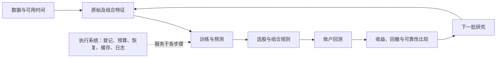
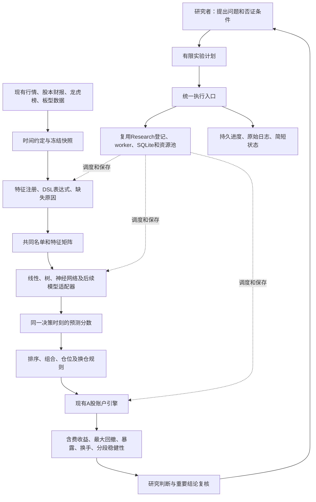

# 执行系统重构方案（2026-10-12）

本次要解决的是：做一个实验，为什么先后需要复制脚本、找历史文件、请多个 Agent 反复检查，然后才真正计算？新的施工目标是：把这些确定性的工作交给一个稳定的程序；Agent 主要负责研究问题、实现新能力、解释异常和判断结果。

这是施工前的方案。完成情况和实测结果另记在交付报告中。本次没有把旧研究结果当作新成果，也不承诺重构后策略收益变好。

## 1. 先把整个量化项目摆清楚

最简图：

略详细图：

表达式生成、模型学习、组合研究是不同层。特征不必独立选股盈利才能进入模型。单列选股是可选诊断。最终比较以账户收益和回撤为主；RankIC用于解释预测。模型名单和初始16列不是项目边界。

## 2. 查了哪些现成经验，具体取什么

以下是已阅读的原始工程文章、官方文档或源码；厂商自报提升不作为本项目的效果证据。

| 来源 | 对本项目的采用或取舍 |
|---|---|
| [OpenAI Harness engineering](https://openai.com/index/harness-engineering/) | AGENTS做入口目录；实现可执行约束和反馈。不能把大量生成代码当质量。 |
| [OpenAI Skills and prompts](https://developers.openai.com/blog/rethinking-skills-and-prompts-for-gpt-6-astra) | 按问题读取上下文；少写重复步骤。此文不构成本次切换模型的理由。 |
| [Anthropic Building effective agents](https://www.anthropic.com/engineering/building-effective-agents) | 固定流程用程序，开放问题才用Agent；先选择最简单可用方案。 |
| [Anthropic Context engineering](https://www.anthropic.com/engineering/effective-context-engineering-for-ai-agents) | 保留高价值上下文，长日志留文件，输出状态和定位线索。 |
| [Anthropic Long-running harnesses](https://www.anthropic.com/engineering/effective-harnesses-for-long-running-agents) | 每次增量交付、可恢复进度；用完整路径验证，避免只声明完成。 |
| [Karpathy autoresearch的实际操作文件](https://raw.githubusercontent.com/karpathy/autoresearch/master/program.md) | 固定评估、有限实验、简短结果表。量化研究不能无限重复优化同一验证集。 |
| [Anthropic Multi-agent research](https://www.anthropic.com/engineering/multi-agent-research-system) | 真正独立的问题才并行；不为所有小变化固定启动两复核加裁决。 |
| [LangChain Deep Agents](https://www.langchain.com/blog/deep-agents) | 计划、外部文件记忆、必要时隔离子任务；现有Codex已具备的功能不再套一层框架。 |
| [LangGraph Persistence](https://docs.langchain.com/oss/python/langgraph/persistence) | 持久化步骤状态；检查点本身不保证副作用只发生一次。 |
| [Prefect Caching](https://docs.prefect.io/v3/concepts/caching) | 缓存必须绑定输入、实现和结果；只看成功标志或文件修改时间不够。 |
| [MLflow Tracking](https://mlflow.org/docs/latest/ml/tracking/) | 参数、指标和产物按实验组织。当前先复用已有SQLite，不为了名字新开服务器。 |
| [Qlib Workflow](https://qlib.readthedocs.io/en/latest/component/workflow.html) | 采用数据、模型、记录器的配置接口思路；后续通过薄适配器验证复用。 |
| [RD-Agent量化场景](https://raw.githubusercontent.com/microsoft/RD-Agent/main/docs/scens/quant_agent_fin.rst)及[循环源码](https://raw.githubusercontent.com/microsoft/RD-Agent/main/rdagent/app/qlib_rd_loop/quant.py) | 参考假设、实现、实验、反馈的分离；不直接安装整套多Agent依赖和付费调用。 |
| [NautilusTrader概览](https://nautilustrader.io/docs/latest/concepts/overview/) | 参考事件驱动与研究/交易分层；目前数据及A股会计约束需要适配验证，不能直接替换后宣布等价。 |

这是工程取舍，不是声称所有框架都已接入。最有用的复用顺序是：先复用本机已工作的执行器，再验证外部组件能替代哪一块。现有SQLite、Python子进程、资源池、pytest足以支撑本次改造。

## 3. 旧执行方式为什么会变重

已找到的具体机制：
- 同一阶段出现大量prepare/run/close临时脚本；脚本又绑定自己版本的清单、前序收据和时间窗口。
- 默认总控每个研究任务都安排研究、两次独立复核和另一次AI裁决，即使只是确定性的接线或文件核对。
- 已完成表达式批次进入矩阵组装时，又调用完整数值审计；提交和恢复也存在重新审计入口。
- 会话凭据是在任务领取提交到数据库之后才写文件；写文件失败可能留下“已领取但凭据没保存”的麻烦。
- 大量完整历史/日志输出给模型，机器能确认的事情由模型再次叙述和确认。

不能据这些机制推算精确Token账单。平台未提供的用量仍记为未知。

## 4. 本次实际施工边界和顺序

| 顺序 | 要交付什么 | 怎么确认不是只写了文档 |
|---|---|---|
| A | 本方案及短AGENTS入口 | 新入口直接指向执行说明；旧V7强制流程明确降为兼容路径 |
| B | 一个持久化计划执行器 | 调用已有Research注册和worker；进度保存在现有研究SQLite中 |
| C | 安全恢复与有限预算 | 中断后关联原实验；失败/取消不悄悄重试；启动次数与时间预算不在续跑时清零 |
| D | 审计复用 | 输入、实现或产物变化使缓存失效；不变结果交接不重复完整数值审计；公式批次原审计不重算表达式，模型和账户按各自原核查范围 |
| E | 简短CLI和领取凭据保护 | 默认只返回步骤状态、实验ID、日志路径；凭据写失败交还任务 |
| F | 清理可再生垃圾 | 列出明确目录、实际字节和删除结果；保护原数据、冻结证据、失败记录、Git与环境 |
| G | 小样本完整运行、恢复反例和一次回归测试 | 真正经过注册、子进程、账户核查；再次执行不产生第二次计算 |
| H | 人能看懂的交付报告和项目导航 | 分清已完成、未完成、清理量及下一步；不把工程通过称为策略成功 |

新执行器首版处理事先准备好的实验提案和已登记实验引用，支持依赖顺序。某步骤生成结果后才能写下一提案的情况，仍由研究者或专用适配器补充下一份计划；本次不写通用代码生成语言或任意Shell执行器。

科学判断不会交给“自动通过”按钮：常规接线和元数据检查由程序处理；新增账户规则、泄漏边界和重要收益结论仍做针对性独立复核。旧总控保留兼容，但不再作为普通工程工作的默认入口。

## 5. 执行器具体应该怎样工作

例如一个计划有“计算特征→训练模型→账户回测”三个步骤：
1. 读取一次有限计划，检查步骤名称、依赖、任务及预算。
2. 找到已登记的步骤就继续使用那个实验ID，不创建第二个实验。
3. 未登记步骤通过现有Research接口冻结输入和代码，并立即记下实验ID。
4. 运行仍由现有worker完成；执行日志写文件。
5. 中断时恢复原worker结果。进程是否结束或收据是否完整无法确认时停止这个步骤，不猜测、不重复启动。
6. 失败保留原记录和已用预算；研究者需要修正具体问题，不能反复包装成“新预算”。
7. 只有核查通过的依赖才允许进入下一步；结果默认给出短状态和定位路径。
8. 已完成步骤复用验证证据。缓存省去重复完整审计与数据载入，仍校验文件内容，不能证明策略有用。

旧脚本归档后需要原路径复原时，从索引恢复原始字节；不批量改写旧冻结计划。

本次默认串行数值步骤，现有资源池继续管理内存和线程。没有为了“上千策略”先开上千进程；未来批量生成应把许多候选放进已有有限批次，由向量化和受控数值并行承担计算。

## 6. 清理规则

| 分类 | 处理 |
|---|---|
| pytest临时目录、Python字节码、lint缓存、重复构建目录、历史浏览器预览profile | 停止相关进程且确认路径后可删除；保存一份精简清理清单 |
| 项目源码、测试、当前虚拟环境、发布Git仓库 | 保留 |
| 原始行情、冻结快照、实验输入/代码/收据、模型和账户产物、失败证据 | 保留；重构不改写历史 |
| 大量旧阶段辅助脚本 | 退出新入口；先查引用和恢复用途。本轮将退休辅助脚本逐一校验后压缩归档；保留当前交接与修复脚本，不破坏旧证据 |
| 旧文档 | 保留原结论；入口标注兼容或历史，避免旧规则继续支配新任务 |

清理不跨出用户授权项目。一次保存清单，不为每个垃圾目录写一篇报告或调用两个复核Agent。

## 7. 长期架构还有哪些工作，不会被这次重构掩盖

执行层改善后，研究主线仍要修复共同成熟日期，再完成完整132列模型与账户对照。随后：
- 特征层：价格量、板型、龙虎榜集中度及交互、财报等，保留缺失原因和信息时间。
- 自动表达式探索：DSL/遗传或其他生成器在有限预算下产生候选；查重、相似性、缺失、暴露和多重试验记录。
- 模型层：稀疏线性、树、神经网络和适合序列/图的数据适配；不能只凭模型名称扩大投入。
- 组合层：分数合成、中性化、持仓约束与仓位研究；与模型变化分开消融。
- 验证层：按时间隔离、标签结束与purge、已见验证集账本、成本和容量、跨期稳健性。
- 外部复用：Qlib/RD-Agent、成熟回测引擎和实验管理组件逐块试接，以本地反例和等价性验证决定采用。

选择新研究方向仍要主动搜索用户认知之外的资料。有限搜索预算约束计算浪费，不把研究范围永久锁在最初几个模型。

## 8. 本次验收的硬指标

同一计划再次执行：新增实验=0，新增训练/账户计算=0。
断点恢复：使用原实验，不能重置启动次数和截止时间。
失败：依赖步骤不运行，失败记录可查。
文件或实现被改动：旧审计缓存不能直接通过。
正常工程执行：不自动调用任何LLM；现有Codex会话用量未知，不能承诺整体Token节省百分比。
清理：给出删除目录数和实际字节，不以目录数冒充研究成果。
完整小样本：至少真实跑通一次已有账户路径，再验证复用。
未达到的条目在最终报告明确列出。

固定导航：[当前总览](PROJECT_MAP.html) · [完整蓝图](ML_SYSTEM_BLUEPRINT_20261005.html) · [工作包计划](CODEX_PROJECT_DELIVERY_PLAN_20261005.html) · [建设记录](BUILD_PROGRESS_20261006.md)
