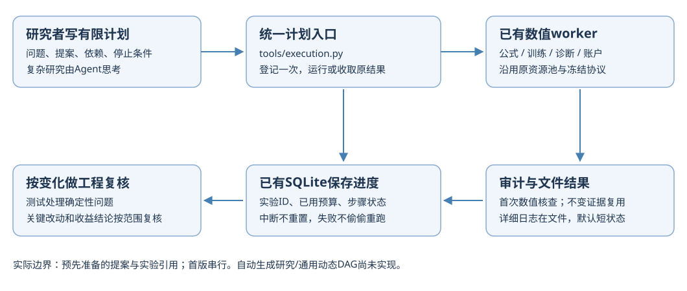

# 执行系统重构：这次具体改变了什么

2026-10-12。本次先阅读14组原始工程文章、文档和源码，再保存施工方案，实施执行入口、恢复和审计复用，并清理本机临时产物。

**核心变化：以后做普通实验，不再每阶段复制一份执行脚本，也不再默认请两名Agent复核后再请另一名Agent裁决。研究者写有限计划，Python执行确定性的步骤。**

这是工程结果。它没有产生新的盈利策略；完整132列模型和账户对照仍未完成。

代码和这组报告已[发布到GitHub](https://github.com/Xenoxym/a-share-quant-research-platform/commit/e23f5d65dc86f4ef8acc47939f0adf9bc34639a6)，Windows与Ubuntu对该源代码提交的完整检查均通过。

## 1. 用一个具体例子理解新的执行方式

假设要比较原68列和新增64列：先分别写好两份模型提案及对应账户提案，或者在前一步出结果后通过专用适配器准备下一份提案。计划写明先后关系、实验上限和时间窗口。

打开新入口，它会：
1. 先找这个步骤是否已经登记，有就使用原实验ID。
2. 没有才通过原Research接口冻结并登记。
3. 原来的worker负责计算；本入口不重新实现模型或账户。
4. 结束后保存状态和日志位置。
5. 下次接着同一份计划，已完成的不再计算；未结束的收取原结果，不能确认就说明阻断。
6. 失败不偷偷重试，预算不在续跑时清零。

首版支持事先准备的提案与实验引用、依赖顺序及串行执行。**没有实现自动生成全部后续提案或通用动态DAG。** 这份报告不会把它们算作已完成。具体命令和计划格式见[执行指南](EXECUTION_GUIDE.html)。

这里“计划”是一份列出有限实验的文件；“恢复”是找回原实验继续收取结果；“审计”是程序检查结果是否自洽，例如账户现金、持仓和交易记录能否对上；“审计缓存”是保存已经完成的检查，文件内容不变时复用。它们都不是新的选股模型。

## 2. 实际建立或修改了哪些代码

| 代码 | 用人话说做什么 |
|---|---|
| src/researchops/workflow.py | 保存计划和步骤，按照依赖登记、运行、恢复；控制实际启动与期限 |
| tools/execution.py | 对外提供run/status，默认只输出短状态、实验ID和日志位置 |
| store.py的登记请求记录 | 防止“实验登记完，父进程没来得及记ID”后重复创建 |
| claims.py及research.py领取入口 | 凭据写入失败时回滚领取，避免又要写管理脚本修复 |
| audit_cache.py | 输入、实现、产物和环境绑定不变时复用实际数值审计；变化时不能直接命中 |
| alpha_execution.py | 收取、恢复和提交共用上述审计入口 |
| expression_assembly.py | 已完成公式进入矩阵时复用核查，不再次独立进行同一完整数值审计 |
| 两个清理工具 | 一个清理可再生成目录；一个校验并压缩退休阶段脚本 |
| AGENTS和执行指南 | 短入口、按需读文档；关键变更才启动限定范围复核 |
| GitHub CI | 纯Markdown/报告变更不再触发整套软件测试；同分支新运行取消旧运行 |

仍使用原SQLite、Research、数值worker、冻结协议和资源池。没有新增数据库、任务服务器、付费Agent框架或依赖庞大的自动研究系统。

## 3. 真的测过什么

在实际研究库中，两次调用同一新计划，引用已完成账户exp-7e0d6f6453a7：
- 两次均完成验证，约0.98秒和0.31秒。
- 新登记实验：0；新启动计算：0。
- 这是核查和复用既有账户，不是再生成一份市场回测。

自动测试还真正执行了小样本冻结子进程、两个费用账户情景和一个公式批次。重点反例包括：
- 登记后、记步骤之前中断：源码改变后仍使用原冻结实验。
- 一次只推进一步：第二次能进入第二步。
- 只读复核：命中或失效都不写数据库。
- 输入、产物、代码或包版本变化：旧审计不直接复用。
- 命中缓存期间文件变化：拒绝。
- 额外字节码文件：不能借缓存隐藏。
- 失败/取消：不重试，不启动后续依赖。
- 同一计划：预算、截止时间和定义不能在恢复时被改写。
- 归档：原始字节能取回，当前交接及修复脚本保留。

公式批次的实际测试中，收取结果→复核→恢复→提交共用了**一次数值审计**。这些阶段仍读文件校验内容，省掉的是重复完整审计及数据载入；公式批次本来不重新计算表达式，学习核查含预测一致性，账户核查含独立账本对账。没有把mtime或“成功=true”当充分依据。

完整回归：**1749项通过、3项跳过、1项因Windows临时文件路径过长失败。** 临时路径267字符，而最终文件230字符；已改为标准库短临时文件，保留原子替换，并在替换失败时清理临时文件、保留旧文件。修复后，受影响的142项检查点、冻结执行、恢复和文件写入测试全部通过，耗时约3分38秒。首次整批与修复后复测合计覆盖1752项通过、3项跳过、0项未解决失败；这是两轮覆盖合并，修改后的全部代码尚未在本机重新跑整套。源代码提交e23f5d6的Windows/Ubuntu CI现已分别完成整套测试、打包及命令模板检查，均通过。

发布检查：[本次实际CI](https://github.com/Xenoxym/a-share-quant-research-platform/actions/runs/38210714726)。software (windows-latest)：1735 passed in 362.23s (0:06:02)；software (ubuntu-latest)：1732 passed, 3 skipped in 318.52s (0:05:18)。

本机整批比公开CI多20项：它们来自此前尚未公开的test_audited_expression_handoff.py实验草稿；公开测试文件与本机同名文件的内容一致。这20项本机检查不代表该草稿已经完成生产接入，本次没有顺带发布它。公开树共1735项，Windows全部通过，Ubuntu其中3项按平台跳过。

本次只委派了一名Agent做限定范围工程复核，找到只读、单步推进、缓存期间改动三个问题；全部加入反例并修正。没有另外启动AI综合裁决，也没有把代理一句“接受”写成收益成功。

## 4. 清理了什么、还保留什么

- 删除165个可再生成目录：约**5.36GB磁盘空间**（约4.99GiB），包含历史测试临时数据、wheel输出和预览profile。
- 1307个阶段临时脚本退出活动目录：原始10.91MB，压缩为4.14MB，逐文件核查原始内容；活动目录剩38个当前交接或修复相关脚本。
- 首轮一个构建目录被进程检查保守跳过；收尾按实际绝对路径确认无进程使用，随源码缓存清理删除。
- 回归结束后清掉再生成的测试目录、源码字节码和构建产物，另释放123,086,909字节。**本轮合计释放5,479,134,685字节，约5.48GB（5.10GiB）。**
- 原行情、数据快照、正式worker_jobs、失败尝试、模型和账户产物、虚拟环境、公开Git仓库保留。

归档不是抹掉失败历史。旧记录若需原路径的辅助脚本，可以按归档索引恢复原字节；旧逐阶段脚本不再是日常入口。原冻结记录没有被改写。

首次清理的总字节汇总字段出现空值；以上释放量从同一份逐目录记录实际bytes相加得到，汇总逻辑已修正。没有为了修汇总重新删一遍原目录或再开展大型复核。

## 5. 为什么不是再装一套复杂框架

参考了OpenAI、Anthropic、Karpathy、LangChain、Prefect、MLflow、Qlib、RD-Agent及NautilusTrader的实际材料。[逐项来源和取舍](EXECUTION_REFACTOR_PLAN_20261012.html)已经写进施工方案。

采用的是具体经验：固定流程交给程序；按需展开上下文；稳定执行器；有限实验；持久进度；可检验结果。没有直接采用Karpathy示例的无限循环，也没有把厂商自身的吞吐/收益宣传当作我们项目的表现。

Qlib/RD-Agent适合继续验证研究接口的复用；NautilusTrader值得研究事件驱动与执行边界。将它们整套装进当前项目，需要先证明数据、时间、A股约束和账户结果能够正确接上。现在不为了框架名称重写已工作账户。

## 6. 还存在什么限制

- 缓存仍要读文件内容，大数据校验会占用I/O；当前对Python审计依赖采用保守绑定，代码变化可能使一些缓存重新核查。
- 计划期限限制新启动；正在收取结果或验证文件不属于整个会话的硬实时截止器。
- 没有自动产生任意下一提案、自动无限搜索或新的并行调度。
- 旧V7总控保留兼容，旧助手脚本保留压缩历史；不是整个项目全部删除重写。
- 桌面聊天和代理没有可读取的精确Token账单，不能给出节省百分比。llm_calls=0仅指这个Python执行入口。
- 清理磁盘不会直接释放同样数量的内存。

## 7. 整个量化项目现在怎样组成

最简图：

略详细图：

**执行层是给研究干活的支撑，不是研究成果本身。** 数据时间、特征矩阵、模型分数、组合和账户比较仍各有职责；下一步继续完成全部64列的预测期数值与132列模型/账户对照，修复共同成熟日期。新特征不必先独立选股盈利才能进模型。

## 8. 自上次汇报以来的路径

外部工程资料与现有实现对照→先保存施工方案→建立公共计划入口→修复中断登记与凭据→连接审计复用→一次限定工程复核和反例→真实库重复调用验收→清理临时目录、归档1307个脚本→完整回归及路径修复复测→GitHub发布与双平台CI通过。

这些是这轮执行系统建设。此前24小时的训练/账户/64列表达式路径仍见[成本复盘](ML_TIME_TOKEN_POSTMORTEM_20261011.html)，没有把它们再算成这次新增工作。

固定导航：[当前总览](PROJECT_MAP.html) · [完整蓝图](ML_SYSTEM_BLUEPRINT_20261005.html) · [工作包计划](CODEX_PROJECT_DELIVERY_PLAN_20261005.html) · [建设记录](BUILD_PROGRESS_20261006.md)
