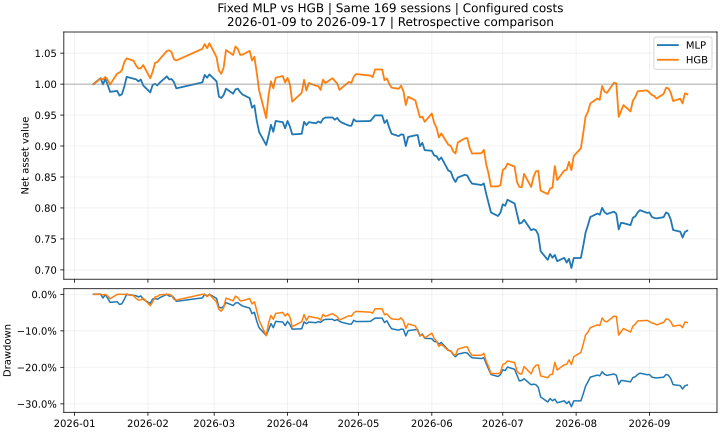

# 五项缺口接续施工：全量准备跑通，矩阵接到训练和账户，模型备份可离线核对

2026-10-13。五项缺口尚未全部完成。本轮跑通了全量数据准备、保存矩阵→真实模型训练→账户回测，以及选定模型的离线备份核对。随后完成一次固定MLP账户对照，结果没有改善收益／回撤。

## 先看这次真正做成了什么

1. **把硬盘里的132列真正准备成了训练和预测输入。** 使用原来的完整文件，按固定的2023—2025训练、2026预测范围读取。得到439,424条成熟训练样本、105,251条预测样本。没有重新计算64项组合特征；这一步只准备输入，实际模型训练在后面的接续试点执行。
2. **把“已有矩阵→训练→账户”连进了原来的执行计划。** 给程序固定的数据目录、学习模板和账户模板，它能自动传递文件与实验编号。合成小样本实际训练了一个岭回归，再运行两种费用情景的账户；模拟登记后中断，恢复时沿用原实验，没有重复训练。
3. **备份范围从数据库扩展到了一个完整学习实验的证据文件。** 包括输入、冻结源码、模型、预测、日志和数据库副本。真实HGB实验共189个文件，文件有效载荷1,017,274,361字节，备份用时19.41秒；复制到另一隔离目录并离线核对，用时5.89秒。没有读取模型执行预测或启动恢复出来的任务。

“合成小样本”用于证明代码能正确连接，不能证明股票策略赚钱。真实HGB在这里用于验证保存与恢复，仍是之前已做过的模型，没有又训练一遍。

## 现在你要开展一个实验，程序怎样工作

例如你想让提升树使用已经保存的132列：

- 先固定训练日期、预测日期、特征和模型参数，写进学习模板；固定股票账户规则、费用和持仓规则，写进账户模板。
- 新的`execution-plan-v3`可以包含一个`learning_from_matrix`步骤：只替换模板中的五项矩阵文件来源，其他研究选择保留。
- 原来的注册入口检查数据键、可知时间和成熟标签，保存这一次实验；原worker训练和预测。
- 已有`account_from_learning`步骤找到这次模型保存的预测，按固定账户模板运行回测。
- 下次继续同一计划时，程序先找已经登记的实验。完成的步骤复用原证据，失败步骤保留，预算不会恢复，不重新创建模型。

这条链现在从**已经保存的矩阵**开始。公式生成、公式计算、矩阵写出尚未成为同一条自动链；不能把这次接线称为完整自动Alpha研究。

## 全量准备的内存，终于有了一次完成时的实测

| 项目 | 实测 |
|---|---|
| 本次新增完整准备次数 | 1；上一批2次失败保留 |
| 准备内部用时／监控总用时 | 113.84秒／115.52秒 |
| 采样进程树RSS峰值 | 5,074,731,008字节，约4.73GiB |
| 启动时可承诺余量 | 约9.06GiB |
| 运行期间最小可承诺余量 | 约3.50GiB |
| 原1GiB运行保留线 | 没有触发 |
| 新增行情fit／预测调用／账户作业 | 0／0／0 |

这是固定范围、固定132列的**数据准备**测量，不包括模型训练占用。每0.2秒采样，瞬时峰值可能高于采样值。小样本已经比较过新旧X、y、权重和记录；本次没有再把原全量读取方式运行一遍，不能报告全量内存“降低了百分之多少”。

保存路径仍是`research/all64_forecast_20261012/full132-checked/`，933,284行。换模型不需要重算已有特征；新增日期、改变名单、频率或公式时才处理对应数据。

## 备份现在能做什么

```powershell
..\.venv\Scripts\python.exe tools/execution.py backup-learning --learning exp-真实编号 --output research/backups/一次固定备份 --max-bytes 2147483648
..\.venv\Scripts\python.exe tools/execution.py verify-backup --folder research/backups/一次固定备份
```

备份默认保存在授权项目内的research目录。拒绝覆盖已有目录，先检查有限字节预算，逐文件复制并核对；失败副本保留，未通过的副本没有完成标记。最终预算包含清单和完成标记两个小文件。SQLite使用现成在线备份接口；副本改为独立文件模式，明确关闭连接，原库不修改。

离线核对只看副本的文件和数据库。测试中已经让原项目目录不可用；真实副本的CLI核对则显式传入不存在的项目路径，仍成功。

**边界：**这是选定学习实验的证据恢复。数据库里其他实验的记录可能存在，但其文件没有一起备份。这里不包括完整行情历史、所有账户快照、直接启动迁移后的研究库或异盘灾备。两份真实副本仍在同一硬盘，不能抵御该硬盘损坏。模型没有反序列化；文件内容一致也不等于收益可靠。

## 五项缺口分别推进到了哪里

| 五项工作 | 当前证据 | 还没完成 |
|---|---|---|
| 1. 内存效率 | 按列／日期读取已实现；真实132列完整准备通过 | 其他入口的分块读取、其他模型规模的资源实测 |
| 2. 版本检查范围 | 修复真实学习缓存不命中；首次数值核查149.36秒，新只读进程复用9.11秒，未重算 | 不同扩展和环境仍按证据判断；不承诺所有核查固定9秒 |
| 3. 自动衔接 | 保存矩阵→真实MLP→账户完成；新增已完成公式分区→五文件矩阵→学习提案完整小样本通过 | 公式生成／运行／矩阵保存尚未合并进同一持久计划；大矩阵保存资源实测 |
| 4. 扩展与恢复 | 元数据库及真实学习证据恢复通过；固定表格MLP实际试点完成 | 自适应公式、真实序列／图模型、未来预测封存、全项目／异盘恢复 |
| 5. 最终研究验证 | 同数据／规则／169日的MLP—HGB真实账户对照完成，MLP更差 | 严格同名单小市值、真正未见时期及稳健性对照；本次没有新增盈利结论 |

这里的“还没完成”分成两类：前两项在当前132列学习主路径上已经有实际通过的证据，可以支持继续研究；不要求把所有未来模型都测完才使用。后三项还有明确未交付功能或研究证据，不能标成全部完成。序列／图模型等是扩展试点；真正未见时期必须等到事先封存之后取得新数据，无法把已观察的2026结果补写成未见测试。

## 接下来按什么顺序做

1. 本批矩阵链／备份相关回归和首次公开CI已通过；缓存修复的独立新CI见文末。没有为证明文件接线重复训练历史模型。
2. 本轮已补公式产物→矩阵写出的小样本闭环；后续只补其有限计划衔接和大样本资源验证。保留缺失原因，不要求单个特征先独立盈利。
3. 补严格同名单小市值对照，明确相同样本、成熟日期、成本和账户规则；以收益与回撤判断模型增量。
4. 选择一个成本可控的真实序列模型或自适应公式试点；并固定未来评估方案。已看过的2026数据不能改叫未见测试集。
5. 根据以上结果决定扩展，而非默认增加复杂模型、代理或监督流程。异盘备份需要确定授权位置；在此之前只报告本机副本能力。

## 本轮路径简记

核对当前实现与已发布版本 → 记录新的有限施工预算，保留旧失败 → 在改善的内存条件下一次完成真实数据准备 → 接入已有计划的固定矩阵学习步骤 → 用实际合成模型／账户验证中断恢复 → 扩展SQLite与学习证据备份 → 修正副本临时文件及连接释放 → 独立限定工程复核指出小型元数据未计入字节预算，补反例及预算检查 → 一次受影响范围回归。

Token消耗没有可用接口，记未知；没有新增逐阶段辅助脚本、任务数据库或固定代理审批。备份与测试产物留本机，原始数据和模型不上传GitHub。

[项目总览](PROJECT_MAP.html) · [完整蓝图](ML_SYSTEM_BLUEPRINT_20261005.html) · [施工计划](CODEX_PROJECT_DELIVERY_PLAN_20261005.html) · [建设记录](BUILD_PROGRESS_20261006.md)

本批本地最终回归：**58项通过，229.30秒**，覆盖新矩阵链、备份反例、原执行计划、学习／账户适配器及已有真实合成模型账户桥。初次测试失败和修正日志保留。一次限定独立复核无阻断；元数据字节帽意见已修正，并在这58项中通过。源码[31a5a6c](https://github.com/Xenoxym/a-share-quant-research-platform/commit/31a5a6c5182386711a2fb3ae1e83ee85c9616980)的[本批完整CI](https://github.com/Xenoxym/a-share-quant-research-platform/actions/runs/38476533478)通过：Windows1910项／943.28秒；Ubuntu1907项通过、3跳过／293.07秒；wheel及模板两平台通过。

## 接续完成了一个真实模型／账户试点

工程部分完成后，复用原先登记的MLP进行一次启动。它冻结的是旧版全量读取代码，77.86秒时触及Windows可承诺保留线，采样峰值6.97GiB。没有进入fit，失败记录保留。进程稍后退出，但11GiB资源预约记录仍保留（这是预约上限，并非实际仍占用11GiB）；通过现成Research.recover核对精确进程身份后释放，没有编写新恢复脚本或修改失败状态。

由于新版完整准备已经成功，另立了一个明确改变读取实现的有限任务：原模型、原参数和科学条件不变；原失败意图仍计1，本次再允许1，合计最多2登记意图、1实际拟合。原作业没有重启、原deadline没有改写，不因新名字退回旧计数。新计划实际使用v3矩阵步骤，再自动接账户模板。

新版MLP完成439424条成熟训练、105251条预测，worker用时177.95秒，采样峰值4.50GiB，最低可承诺余量约1.78GiB。一次拟合，核查额外拟合0。其预测股票／日期／顺序／UTC时钟与HGB完全一致。worker、准备探针及旧失败的测量范围不同，不将它们包装为严格的新旧性能百分比。

模型是132个数值＋132个缺失标记，经训练范围内填补和标准化，进入8个隐藏单元，再输出股票分数。Adam优化加权平方误差与L2项，固定训练10轮。记录表明到达轮数预算、尚未收敛；没有事后追加轮数，也没有随机验证集来调整停止时机。训练损失从0.1351降到0.003087，没有因此宣布策略有效。

账户用既定每周规则、100只上限、150名保留缓冲、98%目标配置。两者股票预测名单、成熟训练资料、参考文件、日历、费用、快照、账户规则一致，32个选定账户数值核心源码哈希也一致。仅比较原固定HGB与这一个固定MLP，没有先做小市值筛选，没有新增小市值账户。

| 同169个交易日，2026-01-09至09-17 | 区间收益 | 最大回撤 |
|---|---:|---:|
| HGB，含费 | −1.65% | 22.86% |
| MLP，含费 | **−23.66%** | **30.77%** |
| HGB，零交易费用 | +3.53% | 20.26% |
| MLP，零交易费用 | −15.37% | 25.99% |

这些是区间收益，169日的原结果没有报年化。本次固定低预算MLP没有改善该回顾性账户；零费用结果也落后。不能据此否定充分训练后的MLP、所有神经网络或其他数据表示。2026已经被研究过，资料的供应商历史真实性未认证，不能称为真正未见测试胜负。



含费MLP平均股票仓位71.55%、费用81643元、5683笔成交；HGB为84.70%、45403元、3219笔。期末未决市值分别16949元／8037元；全部估零，区间收益为−25.36%／−2.45%，排序没有改变。上述只是诊断，不把换手、仓位或费用单独当作已证实的失败原因。

我从每日权益重新计算收益与回撤。两项限定独立复核分别确认数值及科学边界，没有重跑模型或账户。新增真实拟合1次、账户作业1次／2情景；旧失败训练意图保留，沒有进一步搜索。下一阶段继续补公式→矩阵和严格小市值／时间隔离对照，而不沿着这一结果立刻扩大MLP调参。

## 收尾进一步修正：缩小范围之后，真实缓存还必须能命中

真实模型提交结果时，程序又做了完整数值核查。我查到一个具体原因：学习核查导入的标准库函数含一个内部占位对象，上一版不能编码它，于是保守地禁用了缓存。86个相关文件的范围虽然已经缩小，**学习缓存实际上仍未启用**。这是上一批没有用真实学习结果验证跨CLI复用而漏掉的情况，不能把“范围缩小”直接当作“已避免重复计算”。

现在仅识别CPython frozen importlib中确切函数、确切关键字默认值、实际globals字典中的那个占位对象。模块替身、不同默认值、其他函数借用同一对象仍拒绝复用。独立限定复核发现的模块替身组合反例已经补上，21项相关检查通过，204.31秒。原先用不同UUID模块名比较的测试不符合真实CLI身份约定，已改为两个真正独立解释器、同一固定模块名，要求数据库缓存时间完全不变。

真实MLP的修正后首次数值核查149.36秒、额外fit0；随后全新只读Python进程核对同一结果，**9.11秒**，缓存时间和绑定保持不变，没有重新数值计算。9.11秒还包含额外的预先匹配检查，并非单纯函数调用的最低耗时。输入、冻结代码、输出仍逐字节核对，所以缓存命中也有磁盘读写。

源码修复[21bdfef](https://github.com/Xenoxym/a-share-quant-research-platform/commit/21bdfefcfc2cdca3f5f26df86a56272f24896c12)的[新完整双平台CI](https://github.com/Xenoxym/a-share-quant-research-platform/actions/runs/38481186715)已通过：Windows1915项／721.51秒，Ubuntu1912项通过、3跳过／303.19秒；wheel及模板两平台通过。前文31a5a6c的1910／1907检查属于上一条代码提交。这个测量证明了真实学习路径的复用；其他扩展及不同导入环境仍需按证据判断，不承诺所有核查都固定9秒。

## 扩展模型前补查了什么成熟实现

下一步序列／关系模型不能把当前132列随便reshape一下。微软Qlib的[GRU实际实现](https://github.com/microsoft/qlib/blob/main/qlib/contrib/model/pytorch_gru.py)接受按特征×历史步排列的输入；其[时间序列数据适配器](https://github.com/microsoft/qlib/blob/main/qlib/data/dataset/__init__.py)按时间和股票索引构造窗口。[GAT实现](https://github.com/microsoft/qlib/blob/main/qlib/contrib/model/pytorch_gats.py)则把同一日期的股票组织成一批。

据此，本项目的下一步应先固定“单只股票过去哪些日期、每个日期哪些特征”的窗口，保留缺失原因和当时可知时间，再接序列模型；关系模型则要把日期内股票关系与普通随机行批次区分开。这是依据源码做的接入判断，不是已经接入Qlib、训练GRU／GAT或证明它们更强。当前MLP仍是表格模型，不称为序列／图试点。已有sequence模块可以复用，是否引入整个Qlib或PyTorch仍按最小案例和依赖成本决定。


## 继续施工：公式结果终于能用公共命令保存成矩阵

前面那次MLP使用的是已保存的132列。本轮继续补了它前面的一段：给程序两份已经计算完成的公式批次编号，它自动找到原始基础列、开发期公式输出和预测期公式输出，合并成学习入口认识的五个文件。

例如，原来有3列基础数据、2种预先声明的公式、4个股票日期样本。这次完整小样本实际运行两个注册公式批次，然后新入口保存5列、4行矩阵；基础值逐项不变，预测期一条缺失数据仍为source_uncovered，没有因为它未知就删掉股票。两种公式全部保留，没做收益筛选。

之后已有learning_from_matrix成功接收新文件并生成学习提案，决策和标签引用保持原样。保存期间把公式求值函数替换成“调用就报错”，测试仍通过，说明这里是复用计算结果。独立CLI读取同一研究库后写出的第二份矩阵，引用标识一致，没有新增登记、fit或账户。

新增公共入口是`tools/execution.py expression-matrix`，具体参数见[执行指南](EXECUTION_GUIDE.html)。复用现有的assemble_registered_expression_batch、merge_prepared_expression_assemblies和assembly_reference，没有新增调度器或任务数据库。

初次检查暴露两项失败：测试取错既有brief计数字段；以及真实Windows写入receipt时的CRLF字节未计入预算。两项均已修正；后者是实际实现错误，新增的“总字节恰少1字节”反例要求失败目录没有有效receipt。修正后13项检查通过，33.72秒；一次限定独立工程复核完成，无剩余阻断。初次日志和部分失败目录保留。

边界依然明确：本次没有重算历史64项，没有新增市场模型或账户。公式调度、保存矩阵还没放进同一份持久计划；当前合并和保存仍需内存，尚未给大规模写出做资源认证。成功目录不覆盖，后续训练直接复用；中断的部分目录保留，不自动重新开始。

本接口与原公式分区、学习派生、矩阵训练账户计划的最终联合回归：**42项通过，155.68秒**。新接口源码的双平台CI将另行核对，不用前一个缓存提交的CI冒充。
