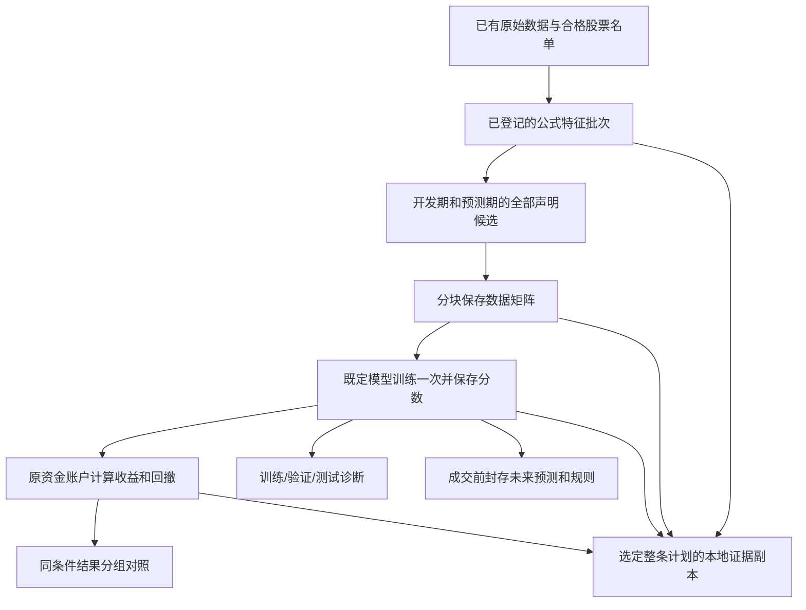

# 基础设施接续：让原有数据和模型更容易复用

> 后续更正（2026-10-14）：本次释放内存后的全量写出已成功；训练分数原本已保存，只是旧诊断未读取。以下保留前一阶段记录，最新事实见[接续验收](FOUNDATION_ACCEPTANCE_20261014.html)。

2026-10-14。当前施工只改基础设施，没有新增真实市场模型、策略搜索或账户回测。旧的132列矩阵和已训练模型保留。下面把“程序已经提供接口”和“已经在全量真实数据上验证”分开写。

## 现在一条实验怎样运行



这些步骤仍由同一个有限计划入口处理，没有新建主管Chat、审批层或任务数据库。公式特征不会先因“单独不盈利”被删掉。

## 1. 保存矩阵：少保留中间大表

旧方法会把开发期、预测期的全部表达式值和缺失原因拼起来，再与原数据做大表合并，随后又建立完整输出副本。新方法按原名单对齐，每次形成最多8192行输出，交给已有的Arrow ParquetWriter逐块保存。最后才发布五文件矩阵的收据。

这叫**分块输出**；输入端的原始底表和两个公式分区仍在内存里，不能说已经实现所有输入的流式读取。新代码不会重算既有64项公式。历史933284行×132列矩阵仍可继续训练；本次写出优化是为了以后合并新公式时不反复制造整表副本，不是要求重新计算旧特征。

部分写出失败时，目录保留且没有完成收据，不自动覆盖重试。跨块重复股票日期、缺失行、改变声明、超字节预算和最后一步失败都应拒绝交付。

## 2. 自动衔接：恢复使用原登记

新增execution-plan-v4，可以一次声明：开发公式 → 预测分区 → 矩阵 → 学习 → 账户。已有v1—v3入口继续可用。

如果模型已登记，中断后使用原实验；如果恰好在矩阵保存后、模型登记前中断，则对照原底表和两个已审计批次，逐块精确核对矩阵的值、缺失原因、股票和时间，再继续登记。只检查矩阵自己附带的校验记录不够：被修改的矩阵可能连同自己的记录一起改写。这条反例已经纳入测试。

不重算公式、不退回失败预算、不因恢复而多训练一次。未完成的矩阵、未知进程和失败实验仍保留。

## 3. 结果诊断：不伪造训练期或验证期

新增可复用的三段诊断接口，要求明确日期、用途和是否用于选型：

- 训练期：已拟合模型在训练区间的回放，只能描述拟合程度，不能当作当时可交易的历史回测。
- 验证期：开发时用于比较方案、选择参数的时期。
- 测试期：模型拟合后的评估时期；反复查看过的历史仍不自动成为真正未见测试。

报告保留未观察和未成熟标签的数量，不把未知收益当作零。原始收益目标可报告MSE和MAE；若模型学的是排名、去均值或标准化目标，暂不把其分数与原始收益计算这两项误差，明确注明尺度不同。RankIC保留为排序诊断；账户收益和回撤仍由账户引擎计算。

旧实验没保存训练/验证分数，就显示缺失。本次读取真实MLP保存的105251条预测，105241条有已知收益，10条仍未知；训练和验证段缺失。没有为了补报告再训练模型。

历史账户索引按共同股票名单集合、日期/持有区间、数据快照、费用/账户规则、实际消费端源码分组。模型打分造成的名单排序不同不会被误认成股票池不同；不同实验ID也不是拆组理由。不同条件的历史结果可以并列查看，不做一个混合总排行榜。

## 4. 选定整链的证据恢复

新增选定完成计划的备份：原输入、冻结作业、模型与预测、原生账户、对应行情快照及SQLite元数据库。核对在副本上完成，可以让原项目路径不可用。

这是**可离线检查的完整证据副本**，不自动激活搬迁后的worker。仍不包括所有市场历史、计划之外的全部来源祖先或全项目运行迁移。SQLite是整库元数据快照，含未选中实验的记录，但没有其全部产物。当前支持本次alpha批次/学习/账户链，不代表所有旧technical或ML计划都可直接使用。同盘副本也不能抵御硬盘损坏。

## 5. 未来预测封存

新增入口使用当前真实系统时间，在下一次成交前复制**完整原预测文件**并固定账户规则。每行必须满足：信息决策时刻 ≤ 实际封存时刻 < 下次成交时刻 < 目标收益结束时刻。过去已发生的预测不允许补封，也不能静默裁剪出一个有利子集。

封存绑定实际已完成学习实验，不读未来收益、不重新预测或拟合。复制过程中若来源被替换，即使原件和副本相同，也必须因为不再等于原登记身份而拒绝。可以离线核对副本。

本地系统时间不是外部可信时间戳；这个机制不声称能证明本机管理员没有故意改写文件或时钟。真正未来的收益仍要等待数据到来，不能由本次软件检查替代。

## 使用已有入口

以下路径、模型和预算应替换为实际登记内容；不是在空仓库直接复现历史收益的命令。

```text
python tools/execution.py run --file PLAN.json --session SESSION.json
python tools/execution.py learning-diagnostics --learning EXPERIMENT_ID --max-rows 200000 --output research/diagnostics.json --max-bytes 1000000
python tools/execution.py comparison-index --accounts ACCOUNT_ID_1 ACCOUNT_ID_2 --output research/comparison.json --max-bytes 1000000
python tools/execution.py backup-plan --plan PLAN_ID --output research/plan-backup --max-bytes 100000000
python tools/execution.py verify-plan-backup --folder research/plan-backup
python tools/execution.py seal-predictions --learning EXPERIMENT_ID --protocol RULES.json --output research/prediction-seal --max-rows 200000 --max-bytes 100000000
python tools/execution.py verify-seal --folder research/prediction-seal --max-rows 200000 --max-bytes 100000000
```

只读诊断不登记新实验；研究输入、备份和真实账户产物均留本机。

## 还有什么不能说完成

- 全量新矩阵写出的实际资源验收，需要看本次有限尝试的结果；小样本通过不代替全量成功。
- 严格同名单小市值/固定规则的正式账户来源仍需接入。当前账户收据与“拟合模型身份”存在耦合，不能把规则伪装成synthetic_stub或假模型来凑完成；原历史小市值账户也不能直接冒充本次同条件对照。
- 真实训练/验证期诊断，需要原始已保存分数或明确登记一次不拟合的模型回放；本次没有这些旧分数，不能补写成已有。
- 异盘灾备、搬迁运行和未来收益不在本次已完成声明中。序列/图模型和复杂策略盈利仍是之后的研究，不是本阶段基础设施验收条件。

## 已取得的工程证据

本次最终相关回归：**105项通过，421.58秒**。覆盖11个直接相关测试文件，包括实际合成公式→矩阵→模型→账户、登记前中断、改值后重新封收据、原目录不可用的离线整链核对、非收益目标单位、未成熟标签和封存时点。软件合成案例不代表真实市场策略有效。

源码已发布为[33d4ed4](https://github.com/Xenoxym/a-share-quant-research-platform/commit/33d4ed44d807b48ce4b5155ca1d1869df8a45ac2)。[该提交的完整CI](https://github.com/Xenoxym/a-share-quant-research-platform/actions/runs/38524544649)已成功：Windows **1971项／561.13秒**；Ubuntu **1968项通过、3跳过／566.38秒**。wheel打包和模板两平台通过。仅文档更新沿用已有路径过滤，不重复跑整套软件CI。

## 全量试写的实际阻断

改码后按预算只启动1次全量试写：运行**716.14秒**后，可承诺余量触及1GiB保留线，程序终止。启动时全机可承诺余量5.92GiB、空闲物理内存11.46GiB；本次自有进程树RSS峰值2.17GiB，最低全机可承诺余量0.92GiB，物理可用仍有7.72GiB。

阻断的是Windows承诺内存，**不是磁盘不足**。RSS和全机commit不是同一指标；本次没有记录进程私有承诺量，不能把全机余量的下降直接分摊给本任务或其他程序。本次实际启动并持续监控，使用1GiB运行保留线，没有重复同码尝试。

最后读到预测分区的seat_net_07，尚未开始最终矩阵写出，目标目录不存在。旧933284行×132列文件和原模型仍在原处。因此，这次不能证明新版全量写出成功，也不能用两个不同停止阶段的RSS声称已经测出新旧性能改善。输入分区驻内存及读取成本仍需继续优化。

这是本次停下的实际原因。基础设施**尚未全部完成**，没有新的盈利发现。

## 用真实旧结果验了什么

MLP和HGB的105251条原预测均已只读提取诊断；同样105241条收益已知、10条未知，35个有可计算排序相关的日期。两者的实际目标都是date_centered，即相对当日均值的收益，故MSE／MAE对原始收益均不报告。两者旧训练／验证分数都缺失。

原两个169日账户被程序归入同一可比条件组：规范排序后的共同名单、参考价、持有期、费用、数据快照和消费端代码一致。指标来自原保存账户，没有重跑：MLP含费区间收益−23.66%／最大回撤30.77%，HGB−1.65%／22.86%；不能据此报告新的收益进展。

实际旧MLP预测已由正式入口验证：因为成交日期已过去，封存被拒绝，且没有建立输出目录。未来封存机制的小样本成功，不会给这份历史数据补上“未见”身份。

选定完整合成链的副本包含4个实际实验、868个文件、9591163字节；原项目目录临时不可用时，副本核对通过。此规模是软件演练，不是全市场或真实模型的灾备规模。

本机初版MLP诊断未绑定目标尺度、初版索引按排序和producer身份误拆组，均已由修正版本替代，初版保留但禁止据此下结论；最终版本及状态写在同一阶段清单。没有删除错误记录来制造首次成功。

## 本轮路径简记

原有限预算登记 → 一次未改码探针在输入读取前因commit余量停止，不能据此定位矩阵峰值 → 实现分块输出 → 补公式至账户的同一计划 → 针对登记前恢复的“改值再重封”反例修正 → 增加尺度正确的结果诊断、严格分组索引与成交前预测封存 → 扩展选定整链离线副本 → 一次相关最终回归与限定复核。

独立工程复核用于具体来源、时间和预算问题，没有固定双代理审批。Token没有可用计量接口，记未知。测试和失败日志保存在本机research/foundation_20261014，市场模型拟合/账户回测新增均为0；软件测试中的小型合成拟合另行计入测试记录。

[项目总览](PROJECT_MAP.html) · [完整蓝图](ML_SYSTEM_BLUEPRINT_20261005.html) · [施工计划](CODEX_PROJECT_DELIVERY_PLAN_20261005.html) · [建设记录](BUILD_PROGRESS_20261006.md)
