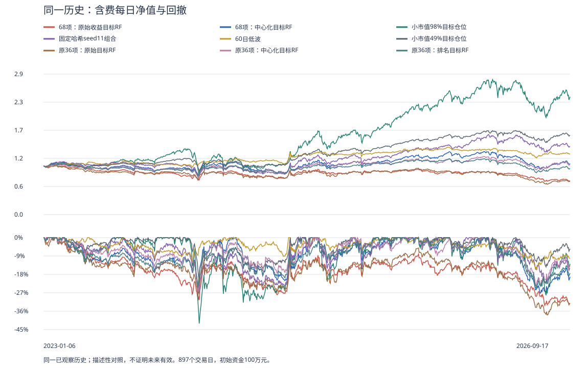

# 增加龙虎榜、板型和财务信息后，模型收益有没有变好？

更新：2026-10-11T07:15:29.492910+00:00。真实2个模型、4条费用账户都已完成；保存净值统计用时160.390秒。以下经济结论待两名独立RESULT复核，原始记录不覆盖。

**这批没有得到足以升级的策略。** 68项中心化模型含费年化1.46%、每日最大回撤−27.14%；原始收益目标模型仍亏损。相同历史的小市值、半仓小市值、低波及固定组合对照保留。新增信息对当前浅层森林的收益提升很小，不能据此宣布这些数据本身没有价值。

## 1. 每周具体做什么？输入是什么？

在每个决策日收盘信息可用后，为共同名单中的每只合格主板股票准备一行68个X，再用一个已训练模型给每只股票打分，按分数取前100只，下一调仓日开盘按账户规则买卖。名单先要求非ST、连续行情历史、流动性与有效公告股本；这不是先筛最小市值。新模型没有把小市值策略作为选股步骤，小市值只作为对照。节假日按实际交易日顺延。

68项不是“每天68个乘过去5天”。它是一行包含不同历史长度摘要的输入：16个价量字段中有1、5、20、60日变化；20个已有组合Alpha；新加8个板型、12个最近龙虎榜、8个已公告财务/股本代理、4个市场环境字段。模型另有缺失标记，总共136个转换输入，68项全部保留。本批没有全市场放宽、没有另外修改调仓频率或账户规则。

| 新信息组 | 例子与数据限制 |
| --- | --- |
| 板型8项 | 连续涨跌停、一字板、天地/地天转变、隔夜跳空与行情间隔 |
| 龙虎榜12项 | 最近报告是否存在/距今多久、披露买卖净额、前一席占比、HHI、机构/北向席位占比；分母为已披露席位，不是整个市场的完整订单流 |
| 财务/股本8项 | 公告股本估计市值、EP/BP、盈利代理、公告距今多久和陈旧标记；不是精准逐日总股本或完整历史修订数据库 |
| 市场4项 | 20/60日上涨广度、市场近期收益与波动 |

## 2. 模型怎样训练，Y是什么？

固定训练区间2020-01-01到2022-12-23，最后只使用截至2023-01-05已成熟的标签，共379842训练行。两个模型分别只训练一次；2023-01-06到2026-09-11产生550711预测行，189次周决策，没有在预测区间重新拟合。此区间已经被研究过，不再称为未见测试集。

Y是**下一次调仓开盘买入到再下一次调仓开盘**的收益，和账户实际持有周期对齐；不是第五天的价格，也不是周一开盘到周五收盘。原始目标直接用这段收益；中心化目标减去该决策日训练横截面的平均收益，让模型侧重相对强弱。两者都是平方误差回归，不直接优化年化、回撤或排序指标。

模型保持同一组受限随机森林参数：32棵树、深度5、叶子至少500行、max_features=0.5、seed11、2线程。缺失填充参数只由训练段生成，各决策日训练权重相等。与旧36项模型相同的是模型参数、目标定义、数据日期、共同名单、每周前100和账户规则；新增32项信息是本次改动。维度变大后森林每次考虑的字段数也会变大，这是同参数信息扩充的结果，不是单项信息的因果效应。

## 3. 同一期间的含费账户结果

账户覆盖2023-01-06到2026-09-17，共897交易日，初始资金100万元。年化按252交易日计算；最大回撤来自每日完整权益。正收益数字不表示未来保证。

| 策略 | 含费年化 | 每日最大回撤 | 期末权益（元） |
| --- | --- | --- | --- |
| 68项：原始收益目标RF | -9.68% | -33.05% | 695,989 |
| 68项：中心化目标RF | 1.46% | -27.14% | 1,053,113 |
| 小市值98%目标仓位 | 28.38% | -41.88% | 2,433,176 |
| 固定哈希seed11组合 | 10.06% | -27.37% | 1,406,419 |
| 60日低波 | 6.45% | -15.85% | 1,249,025 |
| 小市值49%目标仓位 | 14.92% | -22.28% | 1,640,514 |
| 原36项：原始目标RF | -10.05% | -37.69% | 686,031 |
| 原36项：中心化目标RF | 1.08% | -26.39% | 1,039,111 |
| 原36项：排名目标RF | -1.30% | -25.14% | 954,517 |

68项：原始收益目标RF相对同目标36项：年化改变+0.365个百分点，每日回撤改变+4.638个百分点（正数表示回撤较浅）。

68项：中心化目标RF相对同目标36项：年化改变+0.381个百分点，每日回撤改变-0.751个百分点（正数表示回撤较浅）。

中心化增加约0.381个百分点年化，同时回撤更深约0.751个百分点；与14.92%年化/−22.28%回撤的半仓小市值，或6.45%/−15.85%的低波相比仍无优势。原始目标虽然回撤减轻，但年化仍为负。这不是值得停止自动研究并宣布成功的提升。

## 4. 分年表现：改善有没有持续？

2023从1月6日开始，2026只到9月17日，都是不完整年份。数字是该段实际收益，未将部分年份强行年化。

| 策略 | 2023部分 | 2024全年 | 2025全年 | 2026截至9月17日 |
| --- | --- | --- | --- | --- |
| 68项：原始收益目标RF | -19.13% | 8.74% | -1.31% | -19.80% |
| 68项：中心化目标RF | -3.00% | 8.02% | 15.41% | -12.91% |
| 小市值98%目标仓位 | 33.07% | 9.00% | 65.95% | 1.09% |
| 固定哈希seed11组合 | 3.15% | 7.32% | 30.56% | -2.69% |
| 60日低波 | 2.18% | 25.20% | 2.94% | -5.16% |
| 小市值49%目标仓位 | 15.00% | 7.87% | 30.01% | 1.73% |
| 原36项：原始目标RF | -13.09% | -2.44% | 2.35% | -20.95% |
| 原36项：中心化目标RF | -6.79% | 8.41% | 10.69% | -7.10% |
| 原36项：排名目标RF | -6.97% | 7.08% | 10.31% | -13.13% |

图表只读取已保存净值；没有再运行账户。旧七个对照全部复用。

## 5. 费用与账户诊断

| 新模型 | 零费年化 | 零费每日回撤 | 含费年化 | 含费每日回撤 |
| --- | --- | --- | --- | --- |
| 68项：原始收益目标RF | 3.76% | -21.24% | -9.68% | -33.05% |
| 68项：中心化目标RF | 13.47% | -24.53% | 1.46% | -27.14% |

零费用是单独运行的账户反事实，不是把费用加回净利润；成交股数与现金路径可能变化。中心化零费13.47%也低于同目标36项约14.90%，且回撤更深。不能把这一批的差距全部解释为交易费用。

| 新模型 | 买/卖成交笔数 | 累计交易成本（元） | 平均股票仓位 | 期末应收权益（元） |
| --- | --- | --- | --- | --- |
| 68项：原始收益目标RF | 14,885/14,300 | 432,802 | 77.12% | 30,090 |
| 68项：中心化目标RF | 12,938/12,184 | 422,086 | 81.07% | 27,656 |

目标仓位98%并不保证每天实际98%：参与率、整手、现金、涨跌停、停牌和不能及时退出等约束会留下现金。应收权益已包含在总权益中，是企业行为下尚未结算的应收项目，不是期末重复奖励；两模型未解决股票市值均为0。停牌估值、ST退出、缺企业行为来源和权益时间假设警告继续保留，核查账本算术不等于供应商数据完全真实。

## 6. 从结果能学到什么，接下来做什么？

本轮反驳的是“原36项加这32项，放进当前固定浅层森林便会明显提升账户”的具体假设。它不反驳单独事件模型、更合适的表示、其他学习器或组合规则。龙虎榜稀疏且只披露部分席位、财务时点/修订较弱、模型容量及稳定性都可能限制利用；这些是竞争解释，还没有靠本轮分组消融逐项证实。

后续优先：已经通过隔离协议的加权MLP，先生产晋级再同68项真实训练，按账户经济结果与森林对照；并保留滚动成熟标签训练、真正排序损失、分组信息消融、持仓保留、序列/股票关系和有限表达式搜索。当前2fit4账户不重跑，没有靠大量改参数从已看历史挑出赢家。

## 7. 自上次汇报以来的研究路径

原36項中心化未优于对照 → 学习成熟开源框架并完成Qlib六公式/时点及51项薄接入检查（不是全Alpha158或策略复现） → 排名目标训练与真实账户，含费负结果 → 68項完整准备容量 → 生产内存生命周期升级，Windows路径故障保留并仅恢复4项失败检查 → 本轮2个完整68模型/4账户 → 隔离MLP14项小检查通过、0行情模型 → 已验收源码公开，双平台CI成功 → 继续新的非树、时序及组合路线。没有发现应暂停的新收益成果。

导航：[当前总览与架构](PROJECT_MAP.html) · [完整最大蓝图](ML_SYSTEM_BLUEPRINT_20261005.html) · [完整工作包计划](CODEX_PROJECT_DELIVERY_PLAN_20261005.html) · [建设记录](BUILD_PROGRESS_20261006.md)

## 附：实际68个输入字段

- pv16.amount_ratio_5_20
- pv16.amount_volatility_20
- pv16.bias_20
- pv16.bias_5
- pv16.bias_60
- pv16.body_1
- pv16.close_location
- pv16.range_1
- pv16.return_1
- pv16.return_20
- pv16.return_5
- pv16.return_60
- pv16.volatility_20
- pv16.volatility_5
- pv16.volatility_60
- pv16.volume_ratio_5_20
- alpha.boards_price_00_negative
- alpha.boards_price_05_positive
- alpha.boards_price_06_positive
- alpha.higher_order_00_negative
- alpha.higher_order_15_negative
- alpha.lhb_balance_00_negative
- alpha.lhb_balance_10_positive
- alpha.lhb_balance_11_negative
- alpha.lhb_seat_00_negative
- alpha.lhb_seat_07_positive
- alpha.market_regime_00_negative
- alpha.market_regime_02_negative
- alpha.market_regime_14_negative
- alpha.price_liquidity_00_negative
- alpha.price_liquidity_11_positive
- alpha.price_risk_00_negative
- alpha.price_risk_15_positive
- alpha.value_risk_00_negative
- alpha.value_risk_06_negative
- alpha.value_risk_14_negative
- boards.overnight_gap_ratio
- boards.upper_close_streak
- boards.lower_close_streak
- boards.upper_open_lower_close
- boards.lower_open_upper_close
- boards.one_price_upper_limit
- boards.one_price_lower_limit
- boards.quote_gap_sessions
- lhb_latest.lhb_w1_report_present
- lhb_latest.lhb_w1_age_sessions
- lhb_latest.lhb_w1_reported_net_imbalance
- lhb_latest.lhb_w1_single_day_net_to_reported_daily_amount
- lhb_latest.lhb_w1_buy_hhi
- lhb_latest.lhb_w1_sell_hhi
- lhb_latest.lhb_w1_buy_top1_share
- lhb_latest.lhb_w1_sell_top1_share
- lhb_latest.lhb_w1_buy_institution_amount_share
- lhb_latest.lhb_w1_sell_institution_amount_share
- lhb_latest.lhb_w1_buy_northbound_amount_share
- lhb_latest.lhb_w1_sell_northbound_amount_share
- financial.reported_market_cap_proxy
- financial.reported_shares_proxy
- financial.annual_ep
- financial.annual_bp
- financial.annual_profitability_proxy
- financial.annual_publication_age_days
- financial.quarter_publication_age_days
- financial.quarter_stale
- market.market_breadth_20
- market.market_breadth_60
- market.market_return_20
- market.market_volatility_20
