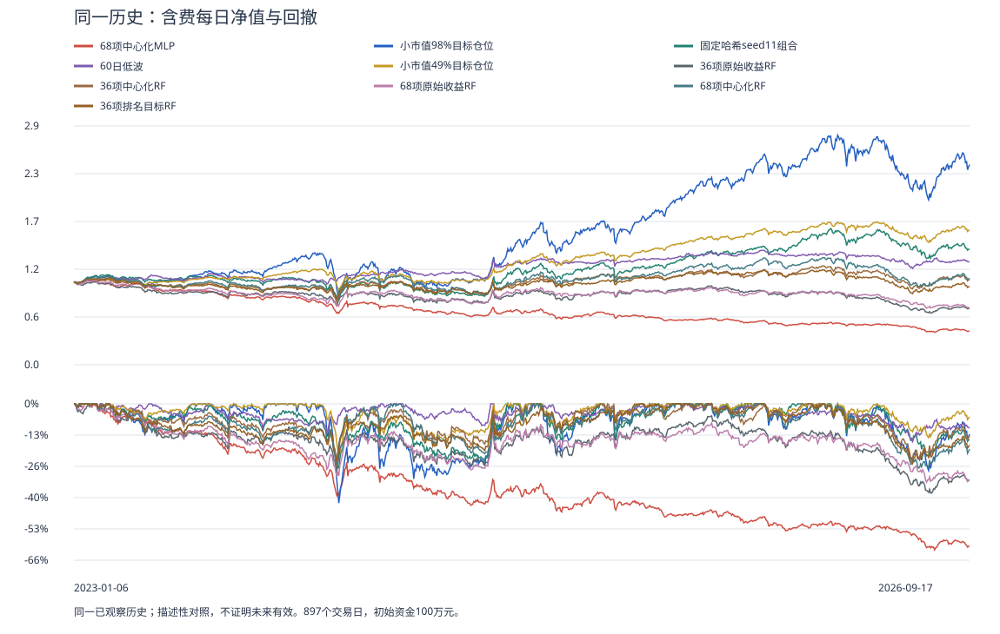

# 换成神经网络后：本次真实账户明显失败

更新：2026-10-11T09:55:53.751859+00:00。一模型、两条真实费用账户已完成；汇总用时211.406秒。两名独立RESULT复核已接受“不晋级”的限定结论，R28已正式归档；此前一轮复核超时及准备错误如实保留。原先提交复核的冻结版本保持不变，本版仅更新实际验收状态，数值和模型没有重跑。

**固定20轮小MLP含费年化-22.22%、每日最大回撤-61.67%，100万元期末剩408,864元。零费也亏损。** 不升级，不作为重要策略成果暂停研究。失败针对这一套具体输入、目标、日期、模型和账户组合，不能推断所有神经网络无效。

## 1. 用人话说：每周到底做什么？

假设周五收盘，拿到当时可知的行情和公告。先找合格主板股票：非ST、连续60交易日行情历史、20日平均成交额至少2000万元、有效已公告股本。每天数量可变，没有先选最小市值；小市值只在后面的表格充当对照。

每只股票一行68个X：16价量摘要、20组合Alpha、8板型、12最近龙虎榜、8财务股本代理、4市场环境。不是68×5天原始K线序列。比如同一行里有过去5日涨幅、60日波动、是否最近上榜、披露席位集中度、财报公告距今多久。

使用训练期生成的中位数填充和均值/标准差，加68个缺失标记，得到136输入。模型给每只股票输出相对收益分数。同日取前100只，每股目标权重0.98/100；下一调仓日开盘尝试买卖，随后逐日算现金、股票市值、应收权益，下周重新选股。节假日按实际交易日顺延。实际平均股票仓位68.96%，目标98%不保证始终满仓。

## 2. 训练目标是什么，怎样优化？

只训练一次，2020-01-01至2022-12-23的379,842条成熟训练行，仅使用截至2023-01-05成熟标签。2023-01-06至2026-09-11产生550,711预测行、189次周决策，后段没有重训。这段历史已被研究，不称未见测试集。

Y是下一次计划调仓开盘到再下一次调仓开盘的收益，减去同日训练股票平均收益。不是第5天绝对价格，也不是周一开盘到周五收盘。正Y代表相对更强。

136输入→32个ReLU隐藏单元→1输出。Adam通过反向传播调整权重，优化日期等权的平方误差与L2正则；它不直接优化账户年化/回撤。固定参数20轮、batch2048、alpha1、学习率0.001、seed11、2线程。打分→选股→账户是训练之后的经济评价。

实际20轮，训练损失从0.06614099降到0.00277317，仍未收敛。没有内部随机验证拆分，训练loss下降不代表盈利；不得事后私自重训，增加轮数或输入变换都是新实验。

## 3. 同897交易日，对比九个旧账户

2023-01-06至2026-09-17，初始100万元，年化按252交易日、最大回撤从每日完整权益计算。九个旧模型/账户直接复用保存结果，0旧fit/0旧回测重跑。

| 策略 | 含费年化 | 每日最大回撤 | 期末权益（元） |
| --- | --- | --- | --- |
| 68项中心化MLP | -22.22% | -61.67% | 408,864 |
| 小市值98%目标仓位 | 28.38% | -41.88% | 2,433,176 |
| 固定哈希seed11组合 | 10.06% | -27.37% | 1,406,419 |
| 60日低波 | 6.45% | -15.85% | 1,249,025 |
| 小市值49%目标仓位 | 14.92% | -22.28% | 1,640,514 |
| 36项原始收益RF | -10.05% | -37.69% | 686,031 |
| 36项中心化RF | 1.08% | -26.39% | 1,039,111 |
| 68项原始收益RF | -9.68% | -33.05% | 695,989 |
| 68项中心化RF | 1.46% | -27.14% | 1,053,113 |
| 36项排名目标RF | -1.30% | -25.14% | 954,517 |

相较68项中心化森林1.46%/−27.14%，MLP的收益和回撤都明显更差；半仓小市值14.92%/−22.28%、低波6.45%/−15.85%同样更好。“固定随机11”的11是种子，固定哈希规则选100只，不是每周随机换11只。

## 4. 分年、净值、费用和账户

2023、2026为部分年份，表中是实际区间收益，没有强行年化。

| 策略 | 2023部分 | 2024全年 | 2025全年 | 2026截至9月17日 |
| --- | --- | --- | --- | --- |
| 68项中心化MLP | -20.98% | -24.13% | -18.69% | -16.12% |
| 小市值98%目标仓位 | 33.07% | 9.00% | 65.95% | 1.09% |
| 固定哈希seed11组合 | 3.15% | 7.32% | 30.56% | -2.69% |
| 60日低波 | 2.18% | 25.20% | 2.94% | -5.16% |
| 小市值49%目标仓位 | 15.00% | 7.87% | 30.01% | 1.73% |
| 36项原始收益RF | -13.09% | -2.44% | 2.35% | -20.95% |
| 36项中心化RF | -6.79% | 8.41% | 10.69% | -7.10% |
| 68项原始收益RF | -19.13% | 8.74% | -1.31% | -19.80% |
| 68项中心化RF | -3.00% | 8.02% | 15.41% | -12.91% |
| 36项排名目标RF | -6.97% | 7.08% | 10.31% | -13.13% |

MLP四段含费年份都为负，零费四段同样为负。图只读已保存净值。

| 账户 | 年化 | 每日最大回撤 | 期末权益（元） |
| --- | --- | --- | --- |
| 零交易税费与滑点 | -10.45% | -39.04% | 675,229 |
| 配置税费与滑点 | -22.22% | -61.67% | 408,864 |

零费是独立现金与成交路径，不能把累计费用直接加回利润。零费年化−10.45%已亏损，问题不能只解释为摩擦。含费累计成本368,061元、买/卖成交14,837/14,545笔；年化日波动18.77%，日收益Sharpe（无风险0）-1.245，Calmar -0.360。收益/回撤是主要决策指标，其余用来诊断。

期末应收权益17,638元已含在总权益中，不能再加一次；未解决股票市值0元。最大账户算术误差约5.1e-09元。停牌估值、ST退出和企业行为时间/来源警告继续保留；算术一致不能证明供应商数据完全真实。

## 5. 反驳了什么，下一步怎么做？

本次否证“完整68项+当前20轮小MLP+周前100优于对照”的具体假设。未收敛、长期固定训练区间漂移、稀疏事件与异质数值输入、MSE与最终选股目标差异，是竞争解释，尚未通过消融区分。不能据此宣布龙虎榜、基本面或神经网络本身无价值。

仍保留分组信息、训练集限定的分位数变换、近期滚动成熟标签、真正排序/组合目标、表格神经集成/数值嵌入、序列关系、保存评分的持仓保留，以及有限Alpha表达式搜索。按最小否证与账户结果选择，不永远固定16项或一类树。

[2022表格基准的方法](https://arxiv.org/html/2207.08815v1)排除了时间序列并移除缺失数据，不能直接代表本项目；[TabM官方说明](https://github.com/yandex-research/tabm/blob/main/README.md)给出共享参数集成和数值嵌入；[Qlib任务管理文档](https://raw.githubusercontent.com/microsoft/qlib/main/docs/advanced/task_management.rst)给出滚动任务/训练/汇总分工。这些目前是设计启发，没有实现或证明A股收益。

当前工程缺口：旧学习评分来源与新账户代码绑定过紧，复用评分仍会重播学习审计的预测；真正持仓保留还需读取各费用账户实际持仓，不能用“上期想买的名单”替代。下一有限工程阶段先建立版本化复用契约，为0重新拟合的组合实验准备入口，保留旧模型和收据。

## 6. 代码与验证各做什么？

| 模块 | 作用 |
| --- | --- |
| models.py | MLP与森林共享输入边界、训练填充/标准化、权重和单次拟合协议 |
| learning.py、learning_artifacts.py、checkpoints.py | 成熟训练/预测行，保存模型、真实迭代和训练轨迹；生产接入另有13项真实工程检查 |
| portfolio.py与technical账户引擎 | 分数变189周目标，税费与可成交限制下算897日权益 |
| 本轮有限执行器 | 登记1模型/两账户，限制资源、时间、输出，保存失败和终态 |
| 净值汇总与独立复核 | 从保存数据统计收益/回撤；不等于再次回测 |

学习完整操作786.250秒，账户完整操作1314.359秒。原生学习239.125秒，峰值约6.052GiB。准入仍检查14GiB物理可用/9.5GiB可承诺余量；保留全部原训练行与68项。

## 7. 自上次报告以来的路径

完整68双浅森林否证 → 隔离MLP14项小检查 → 原生生产接入13项检查 → 一次379,842行市场训练/550,711预测 → 两条897日账户 → 与九个旧策略比较：含费和零费均显著亏损 → 扩大表格表示、滚动学习、组合规则研究。期间GitHub CI真实失败，旧测试把树参数传给MLP；修复单独验收，不把工程检查当策略成果，不重复行情fit。

导航：[当前总览与架构](PROJECT_MAP.html) · [完整最大蓝图](ML_SYSTEM_BLUEPRINT_20261005.html) · [完整工作包计划](CODEX_PROJECT_DELIVERY_PLAN_20261005.html) · [建设记录](BUILD_PROGRESS_20261006.md)

## 附：实际68个输入字段

- pv16.amount_ratio_5_20
- pv16.amount_volatility_20
- pv16.bias_20
- pv16.bias_5
- pv16.bias_60
- pv16.body_1
- pv16.close_location
- pv16.range_1
- pv16.return_1
- pv16.return_20
- pv16.return_5
- pv16.return_60
- pv16.volatility_20
- pv16.volatility_5
- pv16.volatility_60
- pv16.volume_ratio_5_20
- alpha.boards_price_00_negative
- alpha.boards_price_05_positive
- alpha.boards_price_06_positive
- alpha.higher_order_00_negative
- alpha.higher_order_15_negative
- alpha.lhb_balance_00_negative
- alpha.lhb_balance_10_positive
- alpha.lhb_balance_11_negative
- alpha.lhb_seat_00_negative
- alpha.lhb_seat_07_positive
- alpha.market_regime_00_negative
- alpha.market_regime_02_negative
- alpha.market_regime_14_negative
- alpha.price_liquidity_00_negative
- alpha.price_liquidity_11_positive
- alpha.price_risk_00_negative
- alpha.price_risk_15_positive
- alpha.value_risk_00_negative
- alpha.value_risk_06_negative
- alpha.value_risk_14_negative
- boards.overnight_gap_ratio
- boards.upper_close_streak
- boards.lower_close_streak
- boards.upper_open_lower_close
- boards.lower_open_upper_close
- boards.one_price_upper_limit
- boards.one_price_lower_limit
- boards.quote_gap_sessions
- lhb_latest.lhb_w1_report_present
- lhb_latest.lhb_w1_age_sessions
- lhb_latest.lhb_w1_reported_net_imbalance
- lhb_latest.lhb_w1_single_day_net_to_reported_daily_amount
- lhb_latest.lhb_w1_buy_hhi
- lhb_latest.lhb_w1_sell_hhi
- lhb_latest.lhb_w1_buy_top1_share
- lhb_latest.lhb_w1_sell_top1_share
- lhb_latest.lhb_w1_buy_institution_amount_share
- lhb_latest.lhb_w1_sell_institution_amount_share
- lhb_latest.lhb_w1_buy_northbound_amount_share
- lhb_latest.lhb_w1_sell_northbound_amount_share
- financial.reported_market_cap_proxy
- financial.reported_shares_proxy
- financial.annual_ep
- financial.annual_bp
- financial.annual_profitability_proxy
- financial.annual_publication_age_days
- financial.quarter_publication_age_days
- financial.quarter_stale
- market.market_breadth_20
- market.market_breadth_60
- market.market_return_20
- market.market_volatility_20
