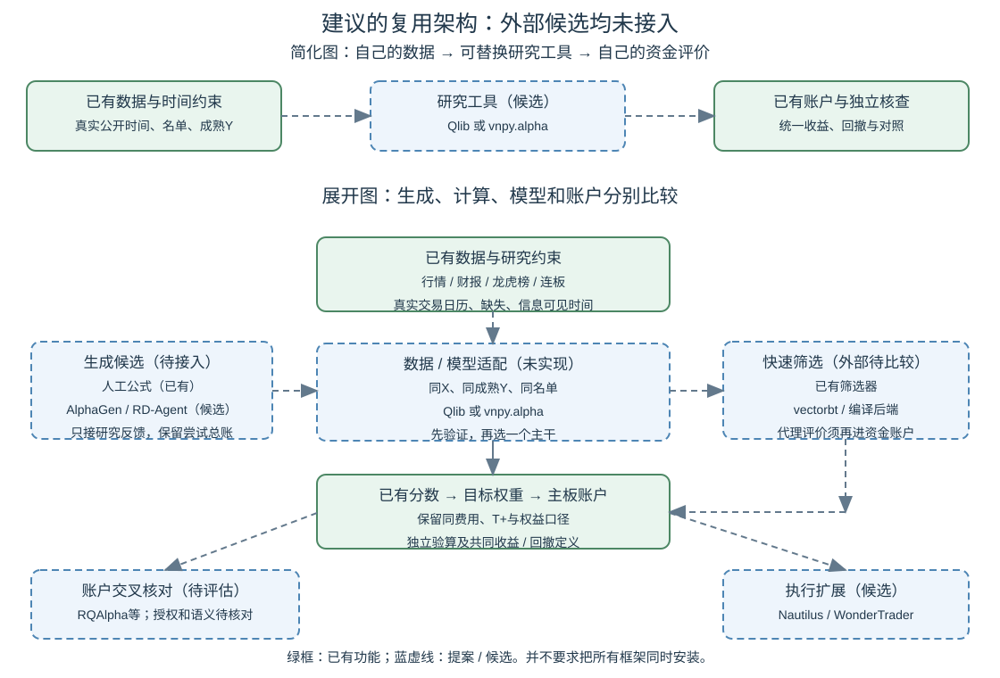

# 成熟量化项目复用审查：哪些应该采用，哪些值得自建

**结论：以前确实搜索和阅读过外部项目，但主要把它们当成方法来源，没有充分把它们当成可以替代我们通用模块的现成软件。这里有重复自建，也有不足以证明“必须自己做”的选择。需要纠正。**

现有项目已经能把特征、模型分数和主板账户连起来；它还不能因此称为优于成熟框架的完整研究平台。模型算法直接使用 scikit-learn，专用数据与验证约束也有保留价值。缺少逐项工时记录，无法负责任地说“过去大部分时间都浪费了”，但能具体指出重叠在哪里，以及接下来怎样减少它。

本报告完成的是来源与实际代码对照。**本轮新增市场训练0、账户回测0、第三方安装0、付费调用0；还没有完成任何外部引擎的本机兼容或速度比较。** 页面中的新架构是提案。正式运行进度仍见[当前总览](PROJECT_MAP.html)；此前接续审批阻断没有被本次资料研究解除。

[当前总览](PROJECT_MAP.html) · [完整最大蓝图](ML_SYSTEM_BLUEPRINT_20261005.html) · [完整工作包计划](CODEX_PROJECT_DELIVERY_PLAN_20261005.html) · [详细建设记录](BUILD_PROGRESS_20261006.md)

## 1. 以前到底学习过什么，有哪些没有做到

我核对了本机研究雷达、顶层来源卡、依赖声明以及当前模型和账户代码，按证据区分“看过”“受到启发”“实际集成”。

| 对象 | 可以查到的以前阅读 | 我们实际做到的程度 |
|---|---|---|
| Qlib | Alpha158/Alpha360 loader、handler、标签预处理、TopkDropout、TRA等选定源码和文档 | 借鉴特征表示、处理分离与目标变换；本机目标接口已实现。没有将Qlib作为研究后端运行 |
| AlphaGen、AlphaForge | 论文和部分公式/组合/搜索实现；阅读深度各不相同 | 形成有限公式集合与组合研究思路；没有完成这些项目的RL、遗传或自动发现系统复现 |
| RD-Agent-Quant | 框架、实验、消融、交易定义及官方金融场景文档 | 写过因子与模型联合搜索的竞争路线；没有安装、运行或集成其循环 |
| NautilusTrader、RQAlpha、VeighNa、vectorbt | 本轮之前，受查文档和顶层来源卡中没有发现相应选型、对照或采用记录 | 不能说此前已认真评估或排除了它们 |
| scikit-learn、pandas、NumPy、DuckDB、Arrow等 | 已列入当前依赖并在代码中使用 | 属于实际复用；六种表格模型的训练算法来自scikit-learn |

可核对的记录：[研究雷达](RESEARCH_RADAR.md)、Qlib表示来源卡（证据保留本机）、Qlib目标处理来源卡（证据保留本机）、[当前模型实现](../src/alpharesearch/models.py)、[依赖声明](../pyproject.toml)。本轮来源卡保存了新查阅的页面、代码位置和阅读边界。

**我的主要遗漏是：研究来源做了一部分，软件选型没有同样系统地做。** 学习别人的公式或模型，不等于已经证明我们应该重做数据处理、实验管理或回测系统。此前着重补齐旧项目的时间与账户漏洞，有其原因；但这不足以替后续每一项通用自建功能辩护。应在扩展之前，先比较现成实现。

## 2. 哪些外部项目与我们的目标真正相关

以下是本轮查看官方资料后的适配判断；“优先”是我们的选择建议，不是本机验证结果。没有使用星数、项目自述的机构客户或性能数字给它们打可信度分数。

| 项目 | 官方公开提供的相关能力 | 对我们的用途与判断 |
|---|---|---|
| [Qlib](https://github.com/microsoft/qlib) | 数据处理、特征表达、多种模型、训练与预测、实验记录、组合回测、滚动任务 | **优先比较的研究主干。** 与我们最希望扩大的特征与ML研究直接相关；需要接入自己的事件数据、成熟标签和名单约束 |
| [VeighNa / vnpy.alpha](https://github.com/vnpy/vnpy) | Alpha158、批量表达式、训练/验证/测试数据、Lasso/LightGBM/MLP、信号与组合回测 | **另一个研究主干候选。** 不应还只把VeighNa理解成期货交易框架；其alpha模块与我们的目标明显重叠 |
| [RQAlpha](https://github.com/ricequant/rqalpha) | 模块化中国市场账户、风险校验、撮合、费用；可扩展数据源 | **A股账户对照候选。** 源码已有T+限制、分红应收、拆股等处理；采用前必须核对其当前商业授权限制 |
| [NautilusTrader](https://nautilustrader.io/docs/latest/concepts/backtesting/) | Rust事件引擎，回测与实盘共享核心，订单/风险/账户，配置化批量运行与数据目录 | **执行系统候选和架构参考。** 当前日线周选股也能评估，不能因其支持细粒度交易就误认为必须有Tick；也不能只凭“支持股票”断言完整支持我们的A股规则 |
| [vectorbt](https://vectorbt.dev/) | 数组批量计算与参数广播，编译加速，组合分析 | **快速筛选候选。** 值得比较是否减少逐策略Python开销；A股语义和真实资金状态必须额外确认，不直接替代最终账户结论 |
| [RD-Agent](https://github.com/microsoft/RD-Agent) | 自动提出、实现、评价并改进因子和模型的研究循环 | **自动研究候选。** 应接入我们的数据与评价入口，而不是直接采用它示例的市场、日期和评价结果 |
| [AlphaGen](https://github.com/ICT-FinD-Lab/alphagen) | 通过RL生成公式集合；公开自有计算后端适配接口 | **自动公式生成候选。** 它可以接自己的计算器；其IC导向仍须经过我们的收益与回撤验证 |
| [WonderTrader](https://github.com/wondertrader/wondertrader) | C++/Python，选股SEL、CTA及更细粒度引擎；信号与执行分离，组合管理 | **补充研究与执行候选。** SEL面向多标的选股，值得比较；本轮仅查官方总览，未审核心实现或测其延迟 |
| [Hikyuu](https://github.com/fasiondog/hikyuu) | C++/Python量化策略分析与回测框架 | **补充计算后端候选。** 本轮仅总览阅读，先列入后续性能与功能比较 |
| [QuantConnect LEAN](https://github.com/QuantConnect/Lean) | Python/C#算法交易引擎与模块化研究/交易基础 | **更广市场的参考。** 自有A股数据与规则的接入成本尚未核实，不在第一批同时接入 |

Qlib已有由配置串起数据、训练、保存、信号诊断与回测的[qrun工作流](https://qlib.readthedocs.io/en/latest/component/workflow.html)；也有[滚动和在线模型管理](https://qlib.readthedocs.io/en/latest/component/online.html)。因此“先把通用ML研究流程自己写完整，再考虑外部框架”并不是必然顺序。

## 3. 本轮看到了哪些具体做法，怎样结合我们的需求

**训练和推理的数据处理要分开。** Qlib的DataHandlerLP区分原始数据、推理处理数据和学习处理数据，也明确这些与train/test日期切分不同。我们可以复用它的接口和处理器，再由我们的接入层保证财报/龙虎榜什么时候可见、Y什么时候已成熟。不能假定框架自动知道本机公告字段的含义。[官方数据处理文档](https://qlib.readthedocs.io/en/latest/component/data.html)

**用已有评分做留仓组合，不必每次重新训练。** Qlib的TopkDropout有topk、n_drop和买卖选择规则。可以固定模型分数，只比较完全重排与保留部分旧持仓的组合规则；最终看同一账户的净收益、回撤与实际换手。n_drop是替换数量，不意味着默认随机淘汰。本轮RD-Agent金融文档有“randomly drops”的概述，但我们核对的Qlib实现默认method_sell为bottom、method_buy为top，必须以所选版本和配置实际执行为准。[TopkDropout源码](https://raw.githubusercontent.com/microsoft/qlib/main/qlib/contrib/strategy/signal_strategy.py)

**应借助独立账户实现发现自己的规则错误。** RQAlpha的StockPosition明确记录不可卖持仓、分红应收，并把应收计入权益；还有登记日、支付日与拆股处理。这与我们自己维护的账户问题直接重叠。以后可在统一原始行情、公司行动和订单规则的条件下比较两边每天的现金、持股与权益，定位首次分歧。某一边不同，不自动说明另一边正确。[账户源码](https://raw.githubusercontent.com/ricequant/rqalpha/master/rqalpha/mod/rqalpha_mod_sys_accounts/position_model.py)、[数据源接口](https://rqalpha.readthedocs.io/zh-cn/latest/development/basic_concept.html)

**批量特征计算也需要查实际内存路径。** vnpy.alpha把表达式和训练数据封装在AlphaDataset，另用AlphaLab管理行情、历史指数成分、数据集、模型及信号。其当前prepare_data源码使用spawn进程池，并将输入表放进每个表达式任务。它有显式max_workers可控制并发，但仅凭这些代码不能推算Windows上的总复制量或峰值，更不能承诺它一定比我们的内存占用低。应以共享输入的小样本实测决定。[AlphaDataset源码](https://raw.githubusercontent.com/vnpy/vnpy/master/vnpy/alpha/dataset/template.py)、[AlphaLab源码](https://raw.githubusercontent.com/vnpy/vnpy/master/vnpy/alpha/lab.py)

**统一指标定义之后，才比较回测表现。** 本轮查到vnpy.alpha的一版账户统计用总收益除以天数、乘annual_days作为annual_return；我们当前账户使用期末净值的252/交易日数次幂。两年总收益44%，简单年化为22%，复合年化为20%。这是公式示例，不是两个项目实际跑出的差异。正式比较应从各自每日权益重算共同指标，不能直接拼报告里的“年化”列。[外部统计源码](https://raw.githubusercontent.com/vnpy/vnpy/master/vnpy/alpha/strategy/backtesting.py)、[本机账户实现](../src/technical/portfolio.py)、[独立核查](../src/alpharesearch/audit.py)

**自动生成不是自动证实。** RD-Agent金融场景已经把因子、模型、反馈串起来；AlphaGen明确提供AlphaCalculator的外部适配接口。这让我们可以先接它们产生的候选，保留自己的信息时点、试验总账和最终资金评价。不应因为生成器能无限提出公式，就把同一历史上筛出的冠军当作新的验证证据。[RD-Agent金融配置](https://raw.githubusercontent.com/microsoft/RD-Agent/main/docs/scens/quant_agent_fin.rst)、[AlphaGen适配接口](https://github.com/ICT-FinD-Lab/alphagen#choice-2-adapt-to-external-pipelines)

## 4. 我们哪些代码重复，哪些自建仍有价值

| 本机模块 | 与外部重叠的部分 | 后续处理建议 |
|---|---|---|
| models.py | 标准模型接口、预处理与fit/predict | 已复用sklearn；增加模型先找现成实现，保留薄适配、训练边界和保存验证 |
| features、operators、dsl | 表达式、滞后、滚动、截面排序 | 与Qlib/vnpy.alpha重叠明显；比较后端复用，不再默认所有新算子都重写 |
| learning、sequence、targets | 数据分段、训练/推理、序列、目标处理 | 用标准数据集/模型后端，补我们的真实交易日历、成熟标签和决策时间限制 |
| registry、cache、feature_storage | 定义、依赖与重复计算复用 | 区分我们的时点/缺失语义与通用缓存实现；减少多个格式与重复物化 |
| portfolio、account、technical/portfolio | 分数到持仓、现金/股票状态、权益与费用 | 自建部分维护成本很高；现有引擎继续保存旧证据，外部后端先作对照，再决定是否替换 |
| researchops、逐阶段执行脚本 | 实验与产物记录、循环、恢复、预算 | 与Qlib Recorder/RD-Agent有重叠；保留试验总账、预算与交接要求，减少每阶段再写一套prepare/collect/report的通用逻辑 |
| 数据快照和事件模块 | 公告/榜单窗口、重复、匿名席位、覆盖与缺失 | **需重点保留。** 框架不能凭空知道本机供应商字段、匿名机构含义或缺失原因；可做插件而不是绑定自家引擎 |
| 独立核查与对照 | 训练样本/预测名单核对、账户算数、相同数据的基准 | **需重点保留。** 可以换引擎，但必须保留外部独立验算与统一口径 |

“我们的数据特殊”不能成为重写一切的理由。大多数成熟系统提供数据源、自定义特征、模型或策略扩展点；首先应证明插件和适配器做不到，再考虑修改核心或完整自建。反过来，公开框架也不会自动修复历史财务修订、退市缺漏或龙虎榜披露时间代理。

维护已有证据与未来停止扩建某模块可以同时进行。旧实验冻结版本保留；让新实验改走兼容的后端，无须为了表示“采用开源”重跑所有旧模型。

## 5. 建议的系统形状：主干可替换，研究约束保留

下面画的是**待验证的复用提案**，不是已经建好的外部集成。绿框为现有可运行功能，蓝色虚线框为待比较或接入的候选。

人话例子：来到一个周末，我们的数据层先确定哪些信息当时已经公开。把相同的X和已成熟Y交给Qlib或vnpy.alpha训练；两者只是候选，初期不要同时把整套系统都装进生产环境。它输出每只股票的分数，再交给我们现有名单和账户入口。一个公式生成器可以替代“人工提出公式”这个步骤，但不能替代验证。一个外部账户引擎可以替代或核对“记账”这个步骤，但不能改掉本次试验的股票名单、时点和成交规则。

适配层至少交换三类普通表：日期×股票的X及可见时间；Y及成熟时间；分数或目标权重及决策/生效时间。附带版本、输入范围、失败记录和资源账。字段之间必须明确转换，不能只凭列名相似就认为口径一致。

**目标是先选一个合适的研究主干，少量专用扩展和独立验算。** 本表列出十个参考，不意味着建设一个同时强依赖十个框架的系统。

## 6. 先复用什么，NautilusTrader放在哪里

针对当前日线、横截面机器学习、周调仓及A股事件信息，我的初步顺序是：Qlib与vnpy.alpha研究主干比较 → 通用计算与实验记录复用 → A股账户交叉核对 → 受控公式生成 → 有明确需要时扩展事件驱动执行。

NautilusTrader的价值不仅是快：它把数据、订单、风控、组合、回测与实时执行拆成组件，共用核心，也提供高低两级回测API。这个模块边界值得学习，若未来需要实时数据和一致的执行流程，它应进入实际候选。但我们目前的主要瓶颈同时在信息、泛化、数据准备和验证，并不只有撮合速度；本轮没有证据证明切换到它会提高收益或解决内存问题。[官方架构](https://nautilustrader.io/docs/latest/concepts/architecture/)、[回测API](https://nautilustrader.io/docs/latest/concepts/backtesting/)

它支持bar输入，所以不是“没Tick就不能使用”。另一方面，本轮没有确认开箱即用的完整本机A股T+1、涨跌停、送转/分红和历史交易规则适配。正确表述是**兼容性待实测**，不是断言它不支持A股。自定义adapter有扩展点；是否值得付出这笔适配维护成本，需要与更贴近中国市场的候选一起比较。[适配器接口](https://nautilustrader.io/docs/latest/concepts/adapters/)

## 7. 版本、授权与运行条件，需要在采用时实际核对

这部分列的是官方当前声明；不能把软件可公开查看等同于没有使用条件，也不能把软件许可等同于数据许可。

| 候选 | 本轮核对到的声明 | 对本项目的具体影响 |
|---|---|---|
| Qlib、VeighNa | 主仓库标为MIT | 后续锁定采用版本、保留适用声明；插件和数据另外核对 |
| NautilusTrader | 主仓库标为LGPL-3.0；当前README的平台表列Python3.13–3.14 | 本机当前Python3.12，需验证实际发行包要求，不能直接升级旧研究环境或混用开发文档 |
| RQAlpha | 当前README及源码明确列非商业使用与商业授权条件 | 公开项目未来用途包含专业研究，采用前核对适用授权；本轮仅查阅，没有复制实现或分发 |
| vectorbt | 官方许可页为Apache2.0加Commons Clause；另有PRO功能 | 不能把PRO功能当免费版能力；后续用途和依赖版本需明确 |
| RD-Agent | 主仓库MIT；当前README称仅支持Linux，多数场景需Docker及模型/embedding配置 | 不是可直接塞入当前Windows环境的零成本替代；先比较接口，未安装Docker/WSL或新增API支出 |

依据：[Qlib仓库](https://github.com/microsoft/qlib)、[VeighNa仓库](https://github.com/vnpy/vnpy)、[NautilusTrader仓库](https://github.com/nautechsystems/nautilus_trader)、[RQAlpha仓库](https://github.com/ricequant/rqalpha)、[vectorbt许可](https://vectorbt.dev/terms/license/)、[RD-Agent运行条件](https://github.com/microsoft/RD-Agent#-quick-start)。采用时以锁定版本的原文为准；本轮尚未审查全部扩展包或提供具体商业许可结论。

本轮资料来自公开主分支与latest文档，尚未锁定用于执行的发行版本。框架名、README和文档存在，不等于我们已经验证其全部正确性、性能、稳定性或作者报告的投资结果。

## 8. 接下来怎样用有限试点作决定

下面是新增兼容性工作顺序，尚未运行，不增加当前R24T的科学预算，也不替代其结案要求。每次开始需单独登记范围、版本和实际有限预算。

| 步骤 | 具体做什么 | 看什么结果、怎样收束 |
|---|---|---|
| OSS01，本轮 | 核对以前学习记录；查官方资料与选定源码；定位重叠与规则差异 | 已交付本报告与来源卡；0新增拟合/账户。没有把阅读标为软件集成验收 |
| OSS02，先做兼容设计 | 固定Qlib/vnpy.alpha候选版本、最小依赖、许可、输入输出；区分能直接接入与需要扩展的字段 | 得到一张逐项可行性表。优先在项目内隔离环境，不改旧研究依赖；本阶段不训练 |
| OSS03，先比算数和容量 | 建议首批最多12只股票×120交易日、8种代表性算子；显式最多2数值进程；使用完全相同输入和预热范围 | 核对滞后/缺失/截面/公司行动处理，记录耗时和峰值。达不到相同语义就先定位差异，不扩大数据。不是盈利研究 |
| OSS04，再跑一个模型闭环 | 只选通过前两步的一个后端；固定一个已有模型和一小段时间，保留原始X/Y/预测及现有账户接口 | 验证接线和可重复性；预先设至多1拟合与2费用路径。不是重新训练全部模型，也不把小切片收益当策略成功 |
| OSS05，账户跨引擎与规模决策 | 在授权适用的候选中选择一个；固定几条订单，覆盖T+、停牌、涨跌停、分红/送转/应收、余钱与手数 | 找出每天现金/持仓/权益首次差异；解释完再扩大。写清保留、采用、替换或不采用哪些模块 |
| OSS06，自动研究试点 | 在前面接口稳定后选一个生成器，限定提案/编译/筛选/账户次数和费用；生成器只接训练与研究验证反馈 | 比较同预算下的候选覆盖、失败定位与账户结果。真正留出样本在筛选结束前不反馈给生成器 |

如果外部后端确实更容易扩展且同样正确，就逐模块采用，而不是出于已有投入继续扩大自建。如果适配成本更高，也应留下具体不兼容案例与测量，不能只说“我们需求特殊”。只有吞吐改善时应报告工程成果；出现可核查的收益/回撤改善才按你的标准报告重要策略成果。

## 9. 本轮研究路径与实际交付

自上一份需求完成度核对以来：检查以前来源卡、依赖和六模型实现 → 补查NautilusTrader/Qlib/RQAlpha/VeighNa/vectorbt/RD-Agent/AlphaGen → 扩展浏览WonderTrader/Hikyuu/LEAN → 选读训练数据、组合、账户、批量计算与统计源码 → 定位可复用边界和未测差异 → 保存本报告、两级复用示意、来源卡与分步计划。

没有进行新市场计算、整套迁移、费用支付或本次GitHub发布；没有改动冻结训练源码、旧账户结果或正式复核裁决。149个当前产品源码/依赖/总览渲染文件的前后内容核对用于确认本轮范围，不能当成软件兼容验收。

报告与本轮来源卡是文档研究成果，未冒充已登记的收益复现或独立双复核通过。部分既有自建内容有实际价值，部分需要停止扩建或替换；应把今后的投入更多放在新信息与新方法的检验、清楚的比较和可持续的复用上。

[当前总览](PROJECT_MAP.html) · [完整最大蓝图](ML_SYSTEM_BLUEPRINT_20261005.html) · [完整工作包计划](CODEX_PROJECT_DELIVERY_PLAN_20261005.html) · [详细建设记录](BUILD_PROGRESS_20261006.md)
