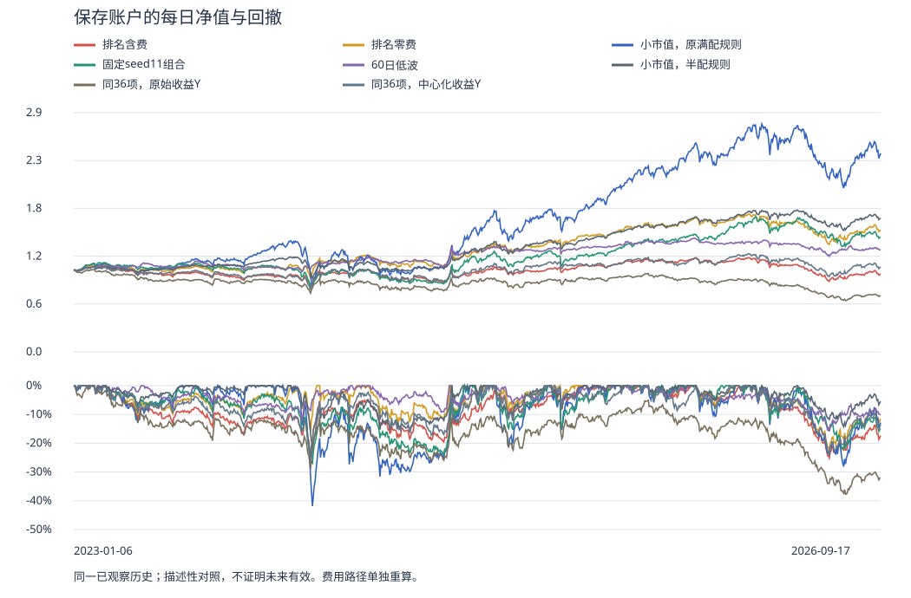

# 排名目标的真实回测：模型完成了，收益没有改善

2026-10-11T04:13:44.496739+00:00 · 任务 task-7204d3bd57ca · 结果整理完成，等待独立结果复核。

**这次已完成1个模型训练、550711条预测和2条真实账户路径。排名目标模型含费年化-1.30%、每日最大回撤-25.14%。它没有超过小市值，也没有显示值得暂停循环来宣布的收益与回撤改善。**

## 1. 我们到底让模型做了什么

每次周调仓之前，拿出当时共同合格的主板股票，给每只股票一行36个数。不是36列乘5天的序列；5/20/60日收益、波动等已经各自压缩成这一行里的单个数。原16项价量，加20项组合表达式，保留单位、缺失原因和可见时钟。板型、龙虎榜、市场状态和价值风险信息已经在这些表达式里使用；这还不是完整68项原始字段的检验。附录列出实际20项。

例如，过去60日收益的居中横截面名次，与当日振幅的反向居中名次相乘。这是“中期价格表现与当日风险”的交互表达。它有双向取值，并不保证只表示强势低波；模型还需学习怎样使用它。

训练用2020年至2022年末已成熟的379842条记录。Y先计算**本次调仓开盘到下次调仓开盘**的后续收益，再转换为当日股票的居中名次：(平均名次−1)/(股票数−1)−0.5。涨8%和涨2%，这次学的是相对名次，收益幅度被弱化；并列使用平均名次。

使用32棵、最大深度5、叶子至少500条的随机森林，种子11、最多2线程。它按回归误差选择树划分，再平均树预测；没有神经网络反向传播，也不是专用成对排序损失，没有直接优化年化收益。

2023年1月6日至2026年9月17日，共189个周决策。每次按分数选前100只、目标股票配置98%，交给原生账户模拟买卖。已持有且仍在目标中的股票可以保留。共同名单有资格要求，**没有先挑最小市值股票再交给模型**；小市值是独立对照。

## 2. 最终钱和风险怎么样

| 策略 | 年化收益（含费） | 每日最大回撤 | 日收益夏普（0无风险利率） |
|---|---:|---:|---:|
| **新：排名Y随机森林** | **-1.30%** | **-25.14%** | 0.01 |
| 小市值，原满配规则 | 28.38% | -41.88% | 0.99 |
| 固定seed11组合 | 10.06% | -27.37% | 0.56 |
| 60日低波 | 6.45% | -15.85% | 0.56 |
| 小市值，半配规则 | 14.92% | -22.28% | 1.03 |
| 同36项，原始收益Y | -10.05% | -37.69% | -0.44 |
| 同36项，中心化收益Y | 1.08% | -26.39% | 0.15 |

同历史段、快照和既定周账户规则；六旧对照读取已保存结果，0复训、0重回测。低波是本批60日版本。固定seed11中的11是种子，不是只持11只；固定选股规则使名单未变化时不必重复买卖。

最大回撤是每天权益相对此前最高点的最深跌幅；它与最后是否赚钱不同。2023和2026是部分年度，不能把下面这两段当全年收益。

| 年份 | 排名Y，零费用 | 排名Y，含费 |
|---|---:|---:|
| 2023（部分年度） | 4.41% | -6.97% |
| 2024 | 22.57% | 7.08% |
| 2025 | 24.19% | 10.31% |
| 2026（部分年度） | -5.95% | -13.13% |

| 操作 | 含准备、执行、收取和核查的总时间 | 采样进程树RSS峰值 | 最低可承诺余量 |
|---|---:|---:|---:|
| 模型操作 | 774.0秒 | 4.70GiB | 5.71GiB |
| 配对账户操作 | 1152.5秒 | 4.67GiB | 5.09GiB |

总时间不是单独fit时间；RSS是本次父子进程树采样峰值。所有Owned进程已结束，错误和未解决进程列表为空；这不代表供应商历史数据已认证。

## 3. 零费用为什么单独看

零费用年化11.95%、回撤-22.14%；含费为-1.30%、-25.14%，年化相差13.25个百分点。是分别重算的资金路径，不是向含费期末值简单加回费用。

含费累计税费与滑点452,766.23元，买入14167笔、卖出13317笔，平均股票市值占权益79.86%。期末权益954,517.36元，应收权益36,039.69元，未解决持仓市值0.00元。应收已计入权益但尚未成为现金，不再额外加一次。目标98%不保证实际每日98%，资金、可成交条件和整数股数会改变实际账户。

保留名单和组合实现值得研究；但这次零费年化也低于原中心化模型约14.90%，不能把没有更强全部归因于费用。忽略含费结果不构成成功。

## 4. 这否证了什么

这次没有支持“同36项、同受限随机森林，只改排名Y就有更好账户表现”。也不证明所有排序学习都无用：本次是名次数值回归，没有专门强化前100名的排序损失，没有滚动重训、序列或股票关系输入，也没判断原始信息是否被组合表达式损失。

三个目标的实际尝试都保留。已反复观察的历史不是未见测试集；供应商历史修订、股本/分红/退市等原有边界继续限制结论。分年、夏普等只辅助诊断。

## 5. 接下来怎么推进

先验证完整68项的一次候选准备，最多1次、0fit/predict/账户；独立资源门槛，核内容身份与旧冻结准备记录，不重跑旧失败基准。小等价测试和六公式接口不能替代完整容量证明。

随后竞争路线保留：直接市值、板型、龙虎榜、财报信息的匹配消融；成熟标签下的滚动更新；真正排序损失、序列/股票关系模型；去重的有限表达式搜索；基于实际持仓的保留缓冲。按证据和单位计算成本选择最小否证，不把36项或一种树当永久范围。

实际阅读了[Qlib数据与缓存文档](https://qlib.readthedocs.io/en/stable/component/data.html)及[固定版本TopkDropout源码](https://github.com/microsoft/qlib/blob/v0.9.7/qlib/contrib/strategy/signal_strategy.py)。共享准备和持仓保留是本项目的推理建议，尚未实测；没有复现外部策略收益，没有付费或扩大为无限搜索。

## 6. 自上次汇报以来的研究路径

中心化目标1模型2账户未超过适当风险对照 → 审查成熟开源研究系统 → Qlib发行与真实接口错误保存、修正 → 六公式/未来前缀及51项薄接入检查 → 26项小准备等价，完整68未验 → 排名准备后资源失败、0fit保留登记 → 你清理内存、新日志和双SOURCE → 本次排名1模型2账户，净收益未改善 → PUB11公开，0703d507双平台CI通过 → 转向完整信息容量与竞争路线。

导航：[当前系统与两级架构图](PROJECT_MAP.html) · [完整最大蓝图](ML_SYSTEM_BLUEPRINT_20261005.html) · [完整工作包计划](CODEX_PROJECT_DELIVERY_PLAN_20261005.html) · [详细建设记录](BUILD_PROGRESS_20261006.md)

## 附：实际20项组合特征

| 20项扩展输入 | 实际公式说明（来自冻结注册表） |
|---|---|
| alpha.boards_price_00_negative | Declared board state or streak conditional on strength/risk/activity: boards.upper_touch_close_inside × pv16.return_5 |
| alpha.boards_price_05_positive | Declared board state or streak conditional on strength/risk/activity: boards.one_price_upper_limit × pv16.return_20 |
| alpha.boards_price_06_positive | Declared board state or streak conditional on strength/risk/activity: boards.one_price_upper_limit × pv16.volatility_20 |
| alpha.higher_order_00_negative | Declared three-way price/activity/risk interaction with board, seat or valuation: parent0 × boards.upper_touch_close_inside |
| alpha.higher_order_15_negative | Declared three-way price/activity/risk interaction with board, seat or valuation: parent3 × financial.annual_ep |
| alpha.lhb_balance_00_negative | Buy vs sell disclosed seat structure, without treating missing reports as no event: buy_hhi - sell_hhi × pv16.return_5 |
| alpha.lhb_balance_10_positive | Buy vs sell disclosed seat structure, without treating missing reports as no event: buy_northbound_amount_share - sell_northbound_amount_share × pv16.volatility_20 |
| alpha.lhb_balance_11_negative | Buy vs sell disclosed seat structure, without treating missing reports as no event: buy_northbound_amount_share - sell_northbound_amount_share × pv16.amount_ratio_5_20 |
| alpha.lhb_seat_00_negative | Reported buying imbalance or seat concentration conditional on market behavior: lhb_latest.lhb_w1_reported_net_imbalance × pv16.return_5 |
| alpha.lhb_seat_07_positive | Reported buying imbalance or seat concentration conditional on market behavior: lhb_latest.lhb_w1_buy_institution_amount_share × pv16.amount_ratio_5_20 |
| alpha.market_regime_00_negative | Fixed declared market condition; no fitted threshold: market.market_return_20 > 0.0 activates pv16.return_5 |
| alpha.market_regime_02_negative | Fixed declared market condition; no fitted threshold: market.market_return_20 > 0.0 activates pv16.volatility_20 |
| alpha.market_regime_14_negative | Fixed declared market condition; no fitted threshold: market.market_daily_cross_section_dispersion > 0.02 activates pv16.volatility_20 |
| alpha.price_liquidity_00_negative | Price strength or reversal conditional on activity (volume_amount_rank_gap means volume-rank minus amount-rank): pv16.return_1 × pv16.volume_ratio_5_20 |
| alpha.price_liquidity_11_positive | Price strength or reversal conditional on activity (volume_amount_rank_gap means volume-rank minus amount-rank): pv16.return_20 × volume_amount_rank_gap |
| alpha.price_risk_00_negative | Price move interacted with low risk, allowing both polarities: pv16.return_1 × -pv16.volatility_5 |
| alpha.price_risk_15_positive | Price move interacted with low risk, allowing both polarities: pv16.return_60 × -pv16.range_1 |
| alpha.value_risk_00_negative | Valuation/profitability/declared size interacting with risk; includes explicit size exposure: financial.annual_bp × -pv16.volatility_5 |
| alpha.value_risk_06_negative | Valuation/profitability/declared size interacting with risk; includes explicit size exposure: financial.annual_ep × -pv16.volatility_60 |
| alpha.value_risk_14_negative | Valuation/profitability/declared size interacting with risk; includes explicit size exposure: financial.reported_market_cap_proxy × -pv16.volatility_60 |
