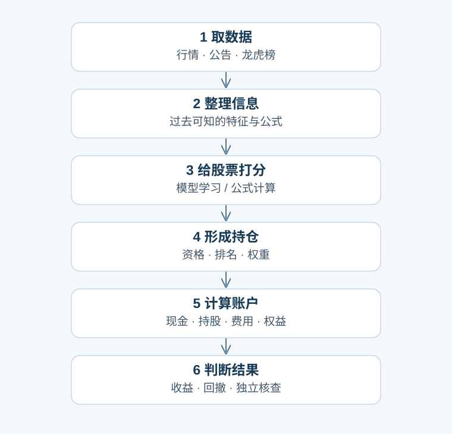
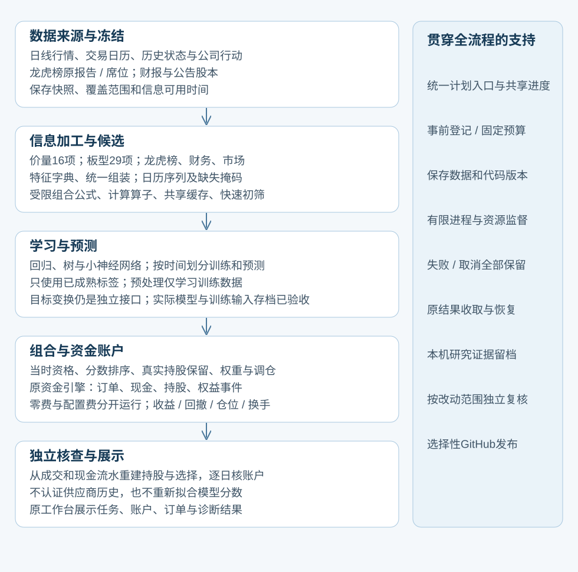

# 项目总览：当前架构、全计划和进度

更新（UTC）：2026-10-11T05:45:18.831846+00:00 · 当前工作包：R26

我们建设的是：把已有市场信息变成可检验的投资方法，再用真实资金账户的收益和回撤判断它是否值得继续。当前软件模块已具备研究闭环的基本接线；真实账户计算与独立接受的进度分别见下文。

## 从这里看整个计划

- [完整68项数据准备容量实测](ML_FULL68_PREPARATION_CAPACITY_20261011.md)（[网页](ML_FULL68_PREPARATION_CAPACITY_20261011.html)）
- [排名模型真实账户结果](ML_RANK_ACCOUNT_RESULTS_20261011.md)（[网页](ML_RANK_ACCOUNT_RESULTS_20261011.html)）
- [这次接续的已完成与未完成，用人话说明](ML_RESEARCH_RESUME_STATUS_20261011.md)（[网页](ML_RESEARCH_RESUME_STATUS_20261011.html)）
- [排名实验：准备成功但训练尚未启动](ML_RANK_PRETRAIN_RESOURCE_FAILURE_20261011.md)（[网页](ML_RANK_PRETRAIN_RESOURCE_FAILURE_20261011.html)）
- [成熟六公式接入现有特征协议：51项实际集成](ML_MATURE_FEATURE_ADAPTER_RESULTS_20261011.md)（[网页](ML_MATURE_FEATURE_ADAPTER_RESULTS_20261011.html)）
- [26项小准备等价：已验证的范围与全量限制](ML_DATA_PREPARATION_EQUIVALENCE_20261011.md)（[网页](ML_DATA_PREPARATION_EQUIVALENCE_20261011.html)）
- [成熟六公式接口：72组真实数值及未来前缀通过](ML_OPEN_SOURCE_EXPRESSION_API_RESULTS_20261011.md)（[网页](ML_OPEN_SOURCE_EXPRESSION_API_RESULTS_20261011.html)）
- [隔离安装真实通过：验收检查故障与明确接续](ML_OPEN_SOURCE_EXPRESSION_INSTALL_AND_CHECK_FAILURE_20261011.md)（[网页](ML_OPEN_SOURCE_EXPRESSION_INSTALL_AND_CHECK_FAILURE_20261011.html)）
- [安装前失败：错误来自自己的wheel布局检查](ML_OPEN_SOURCE_WHEEL_LAYOUT_FAILURE_20261010.md)（[网页](ML_OPEN_SOURCE_WHEEL_LAYOUT_FAILURE_20261010.html)）
- [真实Qlib接口首次试点：下载前失败及原因](ML_OPEN_SOURCE_EXPRESSION_FIRST_TRIAL_20261010_02.md)（[网页](ML_OPEN_SOURCE_EXPRESSION_FIRST_TRIAL_20261010_02.html)）
- [固定Qlib八内核：真实数值与时点兼容结果](ML_OPEN_SOURCE_KERNEL_RESULTS_20261010.md)（[网页](ML_OPEN_SOURCE_KERNEL_RESULTS_20261010.html)）
- [首次Qlib实测：导入成功、取数错误及明确接续](ML_OPEN_SOURCE_KERNEL_FIRST_TRIAL_20261010.md)（[网页](ML_OPEN_SOURCE_KERNEL_FIRST_TRIAL_20261010.html)）
- [真实半批训练目标账户结果与接续](ML_TARGET_PARTIAL_ACCOUNT_RESULTS_20261010_02.md)（[网页](ML_TARGET_PARTIAL_ACCOUNT_RESULTS_20261010_02.html)）
- [固定开源发行与当前环境：实际兼容性](ML_OPEN_SOURCE_COMPATIBILITY_20261010_02.md)（[网页](ML_OPEN_SOURCE_COMPATIBILITY_20261010_02.html)）
- [复核原意见已存档、目录现象与接续限制](ML_REVIEW_RECORDS_AND_RESUME_20261010.md)（[网页](ML_REVIEW_RECORDS_AND_RESUME_20261010.html)）
- [成熟开源项目复用审查：哪些在重复、接下来怎样采用](ML_OPEN_SOURCE_REUSE_REVIEW_20261010.md)（[网页](ML_OPEN_SOURCE_REUSE_REVIEW_20261010.html)）
- [最初要求逐项对照：已完成、部分完成、尚未开始](ML_PROJECT_REQUIREMENTS_AUDIT_20261010.md)（[网页](ML_PROJECT_REQUIREMENTS_AUDIT_20261010.html)）
- [68项训练为何停止及实际资源需求](ML_68_FEATURE_RESOURCE_STOP_20261010.md)（[网页](ML_68_FEATURE_RESOURCE_STOP_20261010.html)）
- [完整最大系统蓝图](ML_SYSTEM_BLUEPRINT_20261005.md)（[网页](ML_SYSTEM_BLUEPRINT_20261005.html)）
- [完整工作包及交付计划](CODEX_PROJECT_DELIVERY_PLAN_20261005.md)（[网页](CODEX_PROJECT_DELIVERY_PLAN_20261005.html)）
- [逐阶段详细建设记录](BUILD_PROGRESS_20261006.md)
- [长期目标与持续探索准则](PROJECT_CHARTER.md)（[网页](PROJECT_CHARTER.html)）
- [本批实验的人话说明](ML_E19_REAL_MATRIX_20261008.md)（[网页](ML_E19_REAL_MATRIX_20261008.html)）
- [这次账户核查与研究路径](ML_E19_ACCOUNT_RECHECK_20261009.md)（[网页](ML_E19_ACCOUNT_RECHECK_20261009.html)）
- [本批全部账户结果](ML_E19_ACCOUNT_COMPARISON_20261009.md)（[网页](ML_E19_ACCOUNT_COMPARISON_20261009.html)）
- [模型保存分数学到了什么](ML_E19_SCORE_DIAGNOSIS_20261009.md)（[网页](ML_E19_SCORE_DIAGNOSIS_20261009.html)）
- [序列接口的人话说明](ALPHA_SEQUENCE_WINDOWS.md)（[网页](ALPHA_SEQUENCE_WINDOWS.html)）
- [训练目标与模型存档：人话说明](ML_TARGETS_AND_SAVED_MODELS_20261009.md)（[网页](ML_TARGETS_AND_SAVED_MODELS_20261009.html)）
- [公式组合研究的人话说明](ML_FORMULA_RESEARCH_20261009.md)（[网页](ML_FORMULA_RESEARCH_20261009.html)）
- [首次真实批次为何失败](ML_FORMULA_CAPACITY_20261009.md)（[网页](ML_FORMULA_CAPACITY_20261009.html)）
- [共享名单存储改造](ML_FORMULA_SHARED_STORAGE_20261009.md)（[网页](ML_FORMULA_SHARED_STORAGE_20261009.html)）

## 现在进行到哪里

本E19阶段：工程3作业（2完成/1取消）；模型登记12项，有收据确认拟合12次、模型核查完成12项；真实账户已计算32情景，其中当前核查接受32情景。上限12次真实拟合/32个真实账户情景，外部费用$0。

排名模型账户含费年化−1.30%、最大回撤−25.14%，未晋级。完整68项数据准备与生产代码验收已完成；开始同模型36→68项信息对照，尚无本批新模型结果。

原回归87项通过、4项因Windows路径过长失败；仅补跑这4项，全部通过，两名独立复核接受后正式完成。原失败记录保留。新批最多2次市场训练、4条费用账户，旧结果直接复用。

## 最简架构：六步就能理解

## 略详细架构：每一步里有什么

图中只画已经实现的有用功能。工程验收表示程序与约束经过检查，不表示有市场优势；模块可用也不表示所有大规模数据路径都已认证。神经网络、图模型、遗传/RL/LLM自动公式搜索仍在后面的计划表。

## 一周例子

示例：周五收盘后，以当时可知的信息给每只合格股票打分；按预先固定的规则选股和分配资金；下一个交易日开盘尝试调仓，此后逐日计算账户。新学习协议默认预测两次计划调仓开盘之间的收益，不是某天的绝对价格，也不是直接训练最大回撤。固定随机对照中的11是种子，不是11只股票。E19已固定共同主板名单、周调仓、100只目标持仓及四个对照；具体实验说明见本批报告。

## 接下来要做什么

1. R26：先检查固定方案与当前容量，再顺序训练68项原始收益目标和中心化收益目标模型，每个模型跑无费/含费两条账户。
2. 把已核查的排名回测、68项数据准备、代码升级报告及当前进度发布到GitHub；原始数据、模型与私密凭据留本机。
3. 根据实际收益与回撤选择下一批，同时探索MLP、滚动训练、真正排序损失、持仓保留和自动Alpha公式，避免长期局部调参。

## 全部工作包：原计划与补充包

原编号表示设计和依赖，不是按编号顺序执行；E15—E18先补接线，E12—E14后补有限执行能力，详见建设记录。没有用完成包数给项目虚构完成百分比。

| 工作包 | 人话说明 | 当前状态 | 已做到什么 / 还缺什么 | 依赖 |
|---|---|---|---|---|
| [R0](LOCAL_STRUCTURE_REVIEW_20261006.md) | 保留旧项目和已有改动 | 已完成首轮 | 旧脏Git与私人证据保留；发布用独立导出仓库。 | 无 |
| [R1](PUBLIC_DELIVERY.md) | 决定哪些文件能公开 | 已完成首轮 | 精确清单及忽略规则，行情/数据库/私密会话留本机。 | R0 |
| [R2](PUBLIC_DELIVERY.md) | 依赖、安装和打包 | 部分完成 | 当前wheel已核查；高级模型依赖随对应工作包接入。 | R0 |
| [R3](PUBLIC_DELIVERY.md) | 跨系统的软件检查 | 已完成首轮 | Windows/Ubuntu CI通过；不证明真实策略有效。 | R1,R2 |
| [R4](WORKER_GUIDE.md) | 新人说明与协作规则 | 部分完成 | 入场与长期准则已保存；许可证尚未决定。 | R1 |
| [R5](PUBLIC_DELIVERY.md) | 发布到GitHub | 已完成首轮 | 公开仓库已建立并多次核查发布，后续持续维护。 | R3,R4 |
| [E00](BUILD_PROGRESS_20261006.md) | 修复财务市场日历问题 | 已完成工程验收 | 执行器与核查器日期范围、60日回看一致；0策略fit。 | 已有task-28ab0d6b9fe2 |
| [E01](ALPHA_CAUSAL_CONTRACTS.md) | 什么时候能知道什么 | 已完成工程验收 | 明确决策、信息可用、成交、标签结束时间，拒绝未来信息。 | E00,R0 |
| [E02](ALPHA_EVENT_SNAPSHOTS.md) | 龙虎榜原报告快照 | 已完成工程验收 | 原报告、席位、重复及窗口可追溯；披露时间仍是保守代理。 | E01 |
| [E03](ALPHA_EVENT_PANEL.md) | 日期×股票的统一名单 | 已完成工程验收 | 行情/事件对齐，缺数据≠没事件；原工程真实切片27日。 | E01,E02 |
| [E04](ALPHA_DAILY_BOARDS.md) | 连板与涨跌停形态 | 已完成工程验收 | 29项定义；日线不能辨别天地板的盘中顺序。 | E03 |
| [E05](ALPHA_LHB_FEATURES.md) | 龙虎榜与集中度特征 | 已完成工程验收 | 34项报告、150项决策投影；部分全缺失，数量不代表有效Alpha。 | E03 |
| [E06](ALPHA_FINANCIAL_MARKET.md) | 财务和市场环境 | 已完成工程验收 | 14项财务、12项市场；保留财务修订及市场覆盖限制。 | E01,E03 |
| [E07](ALPHA_FEATURE_REGISTRY.md) | 特征字典与组装 | 已完成工程验收 | 255项登记定义，工程矩阵221列；包含缺失列，并非221个盈利信号。 | E04,E05,E06 |
| [E08](ALPHA_EXPRESSION_CONTRACTS.md) | 安全组合公式语法 | 已完成工程验收 | 受限表达式组合基础信息，拒绝任意代码执行。 | E01,E07 |
| [E09](ALPHA_NUMERICAL_OPERATORS.md) | 组合公式的计算算子 | 已完成工程验收 | 排序/滞后/差分/滚动按真实交易日历计算。 | E08 |
| [E10](ALPHA_SHARED_CACHE.md) | 共享表达式与缓存 | 已完成工程验收 | 复用中间计算、识别损坏；原小批实测未证明缓存更快。 | E09 |
| [E11](ALPHA_BATCH_REGISTRATION.md) | 先登记再运行 | 已完成工程验收 | 冻结候选、数据、代码、预算；失败和取消留档。 | E07,R3 |
| [E12](ALPHA_BATCH_EXECUTION.md) | 有限计算与中断恢复 | 已完成工程验收 | 监督进程、有限资源、取消与恢复；采样软限制。 | E10,E11 |
| [E13](ALPHA_SCREENING.md) | 快速筛掉差候选 | 已完成工程验收 | 用预测/代理收益诊断筛选，尚不是资金账户回测。 | E07,E11 |
| [E14](ALPHA_CAPACITY_RESULTS_20261007.md) | 实测机器能跑多少 | 已完成工程验收 | 160个公式意图只有8类工作形状；不是160个有效策略。 | E12,E13 |
| [E15](ALPHA_MODEL_INTERFACES.md) | 六类表格模型 | 已完成工程验收 | Ridge/ElasticNet/Huber/RF/ExtraTrees/HGB共同接口。 | E07,R2 |
| [E16](ALPHA_CAUSAL_LEARNING.md) | 训练、目标与预测协议 | 已完成工程验收 | 时间划分/成熟标签/预测名单约束；保存预测与元数据。 | E15,E11 |
| [E17](ALPHA_SCORE_TO_ACCOUNT.md) | 分数变成持仓名单 | 已完成工程验收 | 按当时资格/分数/持仓数/权重生成计划，不自动挖特征。 | E16,E01 |
| [E18](ALPHA_ACCOUNT_AUDIT.md) | 独立检查名单与账本 | 已完成工程验收 | 重建选择并复算现金/持仓/权益/收益，不重新训练。 | E17,E02 |
| [E19](ML_E19_ACCOUNT_COMPARISON_20261009.md) | 首次新流水线真实闭环 | 12模型/32账户证据已重检报告；原父任务未正式结案 | 原12failed保留；后续独立任务完成账户重检。task-32a60b66115c仍active、无submission/review；证据状态与任务结案分开。 | E14,E18 |
| [E20](ALPHA_SEQUENCE_WINDOWS.md) | 序列与事件数据集 | 日历窗口已正式接入，事件序列/真实试点待做 | E20私有30检查，E20B正式32检查；明确每日特征、可知时间/缺失掩码和有限批。没有序列模型。 | E07,E16 |
| [E21](ML_SYSTEM_BLUEPRINT_20261005.md) | 神经网络模型 | 未开始 | MLP→GRU/TCN→Transformer，逐步比较并实测成本。 | E20,R2,E19 |
| [E22](ML_SYSTEM_BLUEPRINT_20261005.md) | 席位关系图 | 未开始 | 当时关系统计→图模型，隔离未来新增关系。 | E02,E20,E19 |
| [E23](ML_FORMULA_SHARED_STORAGE_20261009.md) | 遗传与符号搜索公式 | 有限公式库的八类训练筛选已完成；自适应搜索未开始 | 256有符号公式/128模板/8类完整训练筛选；原G14作业及原归档超时保留，独立恢复已接受。12表现+8探索只是模型输入候选，0新fit/account；GP/RL/LLM自适应搜索未实现。 | E09,E12,E19 |
| [E24](ML_SYSTEM_BLUEPRINT_20261005.md) | 强化学习生成公式 | 未开始 | 固定奖励和反馈范围，防止评价区间泄漏。 | E23 |
| [E25](ML_SYSTEM_BLUEPRINT_20261005.md) | LLM提出受限公式 | 未开始 | 提出假设与表达式，按调用/研究预算核查。 | E23 |
| [E26](ML_SYSTEM_BLUEPRINT_20261005.md) | 组合权重与风险研究 | 部分完成 | 旧系统已有组合/风险实验，新统一流水线研究待E19。 | E18,E19 |
| [E27](ML_SYSTEM_BLUEPRINT_20261005.md) | 工作台展示研究过程 | 部分完成 | 已有任务/账户/结果工作台；新候选前沿尚待接入。 | E11,E19 |
| [E28](ML_SYSTEM_BLUEPRINT_20261005.md) | 记录真正未来的预测 | 未开始 | 可载入实际拟合模型和训练trace的存档基础已由E21C接入；真正未来数据推断与前瞻预测封存仍未开始。旧E19没有保存拟合对象，不可补造；已看历史不算未见验证。 | E18,E19 |
| [E29](ML_SYSTEM_BLUEPRINT_20261005.md) | 备份和灾后恢复 | 部分完成 | 已有位置修复和运行恢复；整库备份与恢复演练待补齐。 | R3,E12 |
| [E12P](ALPHA_WINDOWS_CI_REPAIR.md) | 补充：Windows进程身份 | 已完成工程验收 | 进程身份与启动恢复修复，保留失败迭代。 | E12 |
| [E13B1](ALPHA_BINDING_INDEX.md) | 补充：复用特征绑定索引 | 已完成工程验收 | 复用绑定解析；非同口径实测不宣称精确加速倍数。 | E13 |
| [E13D](ALPHA_SCREEN_DURABLE.md) | 补充：持久初筛任务 | 已完成工程验收 | 正式3作业：2完成、1预期输出上限失败；0fit/账户。 | E12、E13 |
| [E16D](ALPHA_LEARNING_DURABLE.md) | 补充：持久训练任务 | 已完成工程验收 | 合成拟合3次：2完成、1预期不收敛；0真实拟合/账户。 | E12、E16 |
| [E19A](ML_E19_ACCOUNT_COMPARISON_20261009.md) | 补充：金额舍入与原账户重检 | 工程任务已完成，原档案保留 | 24模型场景修正核查+8原对照通过；16同名单比较发布；0新fit/模拟。 | E19 |
| [E19D](ML_E19_SCORE_DIAGNOSIS_20261009.md) | 保存分数的失效诊断 | 完成并已发布 | 保存分数全12诊断完成，9个头部标签超额为负；不改任何账户结果。 | E19,E19A |
| [E20B](ALPHA_SEQUENCE_WINDOWS.md) | 正式序列接口与日线接入 | 已发布；两平台CI通过 | sequence正式32检查；69e20f3 Windows1272/Ubuntu1269+3skip，真实试点和神经模型未做。 | E20,E19A |
| [E21T](ML_TARGETS_AND_SAVED_MODELS_20261009.md) | 补充：成熟目标与私有模型存档 | 已完成私有接口验收 | 实际任务标签E21。四种目标、六合成fit；原35+补3覆盖38条件；原12市场模型权重没有补回。 | E19D |
| [E21A](ML_TARGETS_AND_SAVED_MODELS_20261009.md) | 补充：三个测试构造修复 | 已完成 | 三节点实际补验通过，0fit；启动前XML读取失败保留。 | E21T |
| [E21B](ML_TARGETS_AND_SAVED_MODELS_20261009.md) | 补充：正式目标与模型存档模块 | 已完成并公开 | 正式独立API迁入，当时本地31通过0fit；精确12文件发布，Windows1310/Ubuntu1307+3skip CI成功。实际模型/训练trace存档由E21C接入；目标变换仍是独立接口，正式worker集成待做。 | E21T,E21A |
| [E23S](ML_FORMULA_SHARED_STORAGE_20261009.md) | 补充：共享名单存储与独立核查 | 已完成并公开 | 144生产文件；原29加补13验收42条件，v1/v2各2合成公式共4，0真实公式/fit/account。首次失败保留。 公开提交a21ecc7；Windows1331/Ubuntu1328+3skip CI成功。 | E23,E12 |
| [E23P](ML_FORMULA_SHARED_STORAGE_20261009.md) | 补充：真实32公式容量试跑 | 已完成并公开 | 1正式批次32全完成；7实际依赖/11PV输入列/32原料库。213MB，旧13完整语义一致；473s/1.43GB；0screen/fit/account。 | E23S |
| [E23F](ML_FORMULA_SCREEN_THROUGHPUT_20261009.md) | 补充：八家族训练筛选 | 部分阶段已归档：1/15例 | 复用P32完成32通道，native443s/outer1171.5s接近20min单例上限；全8家族尚未完成，余14案例未启动；先改造重复排序。 归档789.625s、两次原冻结核查；task-d878a2473869完成的是吞吐里程碑，整批仍待接续。 | E23P,E12 |
| [E23C](ML_EXACT_RANK_REUSE_20261009.md) | 补充：精确共同名单排序复用 | 已完成并公开 | 75软件通过；1次真实379842×32/496对全部与原算法/原表精确相同，rank992→32、pair124.25→7.891s；145源码，0fit/account。两名结果接受并归档，未宣称whole-screen提速。 公开提交457a90f；Windows1353/Ubuntu1350+3skip CI成功。 | E23F,E23S |
| [E23G](ML_EIGHT_FAMILY_TRAINING_SCREEN_20261009.md) | 补充：接续七类224公式与筛选 | 已完成本地归档；公开发布待核查 | 224新公式/224新筛选＋首32复用＝256有符号公式/128模板/8类；20候选并非成功策略。双RESULT接受，原7200秒归档超时保留；独立恢复实际完成14次核查，未重置原阶段；0新模型/账户。 | E23C,E23F |
| [E21C](ML_ACTUAL_TRAINING_ARTIFACTS_20261009.md) | 补充：真实训练作业存档与零重训重现 | 实际工程归档、公开发布与新双平台CI完成 | 39项合成条件实际通过，原失败5fit保留；独立短目录恢复5库级+3隔离=8新fit，本机共13合成fit；其中存档容量失败仍计数。实际模型/X/Y/权重/train分数保存与0refit重载接入；145→146源。0新真实模型/账户。 精确15文件发布，新提交Windows1392/Ubuntu1389+3skip通过，打包与模板通过；这些CI中的合成拟合另记，未计入本机13。 | E21B,E23G |
| [E23GR](ML_EIGHT_FAMILY_TRAINING_SCREEN_20261009.md) | 补充：最终裁决超时后的独立恢复 | 已完成；原超时保留 | 原7200秒案例失败，145源/30旧数据库行及完整目录保全。独立7800阶段/5400案例实际14核查，0新公式/fit/account；通过review.next_task_id准确衔接E21C。 | E23G |
| [E23H0](ML_FORECAST_FEATURE_PROTOCOL_20261009.md) | 补充：原生后续期公式执行协议 | 已归档、已公开；实际双平台CI成功 | 51条件实际通过，4隔离批8合成公式。后续X、预热与固定训练名单原生协议接入，v1/v2兼容，146→147源；0真实公式/模型/账户。 实际CI：Windows1443，Ubuntu1440＋3跳过，wheel/template均成功。 | E21C |
| [E23H](ML_FORMULA_CAPACITY_BLOCK_20261009.html) | 补充：固定20候选的真实后续特征 | 原部分阶段已关闭；20项目标由接续补齐 | 旧4项复用、原失败与7声明永久保留；接续E23HR新增16项，共20完整输出。旧7200时钟未重置。 | E23G,E23H0 |
| [E19E](ML_COMBINED_FEATURE_ACCOUNT_RESULTS_20261010.md) | 补充：组合特征的真实模型与账户对照 | 7模型/14真实账户已双复核正式结案 | 16/28/36项与同日置乱标签对照完整完成；累计8拟合意图/16原生登记，含1未知拟合调用失败和1配对账户失败，均保留。正常提升树改善失败基准但仍落后小市值。 | E21C,E23HR |
| [E23I](ML_SYSTEM_BLUEPRINT_20261005.md) | 补充：公式直接选股与条件/平分对照 | 独立研究路线，未开始 | 不伪装成已训练模型；明确零分、平分、资格和现金规则，另登记真实账户。 | E23H,E18 |
| [E23HR](ML_FEATURE_COMPLETION_20261010.html) | 补充：资源恢复后补齐固定特征 | 20特征齐备并正式归档 | 6新任务补齐16项、复用4项；累计9登记/8成功/1旧失败/23声明。两名独立RESULT接受，0新模型/账户。关闭耗时下界1211秒超过600预算，原时钟保留。 | E23H,E23H0 |
| [R23D](ML_68_FEATURE_RESOURCE_STOP_20261010.md) | 补充：直接信息与组合共同输入的真实账户检验 | 68项组装完成；首项训练因可承诺空间不足停止并正式结案；发布与新CI完成 | 68项=原16价量+20组合+32已有板型/龙虎榜/财务/市场信息，933284共同样本；组装峰2.81GiB，首项训练准备峰7.10GiB、执行峰6.74GiB。1失败意图，0成功拟合/账户，实际fit调用未知；非策略有效性结果，未自动重试，未改OS或终止其他应用。 | E19E,E21C,E23HR |
| [R23C](ML_FOUR_MODEL_ACCOUNT_RESULTS_20261010.md) | 四种模型在同36项信息上的资金结果比较 | 真实RESULT已双复核结案、发布与新提交CI均完成 | 极端随机树、随机森林、ElasticNet、Huber各拟合一次；同379842成熟训练/550711预测、相同36输入/周Top100/账户，两费用各真实执行；全部失败历史与零费用对照保留。 | R23D,E15,E16 |
| [R24T](ML_TARGET_PARTIAL_ACCOUNT_RESULTS_20261010_02.md) | 成熟训练目标与组合映射的工程和账户检验 | 真实部分结案；仅1/2模型及2/4路径 | 父task completed；centered配置费CAGR1.08%/DD26.39%，被半仓小市值支配。旧Errno22及全部失败保留；rank未跑。 | R23C,E15,E16 |
| [R24M](ML_SINGLE_PREPARATION_ENGINEERING_20261010.md) | 单次准备数据与旧模型作业兼容 | 实测、双复核、6文件升级、公开与新CI完成 | 单次prepare与旧v1/v2冻结兼容已通过60测试：22微型真实fit+1假失败，0市场fit/0账户；68首次准备峰值仍未证明解决。 | R23C,R24T |
| [R24N](ML_NATIVE_TRAINING_TARGET_ENGINEERING_20261010.md) | 明确原始收益与训练目标的原生接口 | 实际微型验证、双复核、本机升级、公开与新提交双系统CI完成 | 46项测试、10合成真实fit/0市场/0账户；原始/变换/实际Y及单位、存档/名单审计、旧冻结和旧库核查完成。 | R24M,R24T |
| [R24P](ML_DATA_PREPARATION_EQUIVALENCE_20261011.md) | 首次prepare容量与批量吞吐工程 | 26项小准备等价通过、部分结案；全68尚未验证 | 1实际pytest/0fit账户；候选不改变X/Y/名单/权重，生产学习源码未升级。全量另R24PF task-1d0120711bce。 | R24N,R24T |
| [OSS01](ML_OPEN_SOURCE_REUSE_REVIEW_20261010.md) | 现成量化框架比较与复用 | 来源/选定源码对照已完成；外部集成未开始 | 十项候选、23条主来源；通用模块需比较后采用。0新增训练/账户，未测兼容或迁移性能。 | 已有E01/E07/E16/E18；后续独立有限兼容试点 |
| [R25R](ML_RANK_PRETRAIN_RESOURCE_FAILURE_20261011.md) | 只接续未执行的排名目标 | 训练前失败已双RESULT归档 | 379842/550711输入准备，native训练前断言失败；exp-b89345f8998d取消且1意图保留；实际0fit/predict/账户。 | R24T部分结案 |
| [OSS02](ML_OPEN_SOURCE_COMPATIBILITY_20261010_02.md) | 固定外部量化发行与本机兼容性 | 已完成元数据分析及真实双RESULT | 固定4发行/依赖/平台/许可已检查；未做完整安装和后端兼容。canonical OSS03子任务已真实创建。 | OSS01 |
| [OSS03](ML_OPEN_SOURCE_KERNEL_FIRST_TRIAL_20261010.md) | Qlib八基础内核小尺寸兼容性 | 已按失败范围真实结案 | 首次扩展导入成功，但代码后缀取数0行，0比较；双RESULT失败分析通过，不是兼容成功。 | OSS02 |
| [OSS04](ML_OPEN_SOURCE_KERNEL_RESULTS_20261010.md) | 修正证券代码契约后的内核验证 | 小数据120组通过及双RESULT结案 | 1440行/8kernel×15cases；A独立核120/B20，0fit/账户/生产install，完整后端未测。 | OSS03 |
| [OSS05](ML_OPEN_SOURCE_EXPRESSION_FIRST_TRIAL_20261010_02.md) | 隔离Qlib真实表达式与本地数据提供器 | 失败诊断双RESULT及正式结案 | 下载前唯一准备失败；独立诊断仅项目说明文件的发现路径差异。报告02纠正68准入，原失败/意见保留。 | OSS04 |
| [OSS06](ML_OPEN_SOURCE_WHEEL_LAYOUT_FAILURE_20261010.md) | 修正版本发现口径后的实际Qlib接口 | 安装前失败，双RESULT结案 | 143基础版本通过，下载12wheel共3769172字节；误拒dill合法.data/scripts。0环境安装/API/fit账户；不是Qlib不兼容。 | OSS05 |
| [OSS07](ML_OPEN_SOURCE_EXPRESSION_INSTALL_AND_CHECK_FAILURE_20261011.md) | 复用缓存与标准pip脚本映射的接口验证 | 安装通过、检查失败；双RESULT及正式结案 | 13缓存wheel标准pip安装及666成员核验；C.registered在重设配置后报错，0数组/比较/fit账户。后续不用重新安装。 | OSS06 |
| [OSS08](ML_OPEN_SOURCE_EXPRESSION_API_RESULTS_20261011.md) | 复用已装环境的真实公式验收 | 72组实际通过、双RESULT及正式结案 | A独立72原始组；B独立72原始及72未来组；前60逐位同。0fit账户/新安装下载，完整后端未验收。 | OSS07 |
| [OSS09](ML_MATURE_FEATURE_ADAPTER_RESULTS_20261011.md) | 成熟特征薄适配现有协议 | 真实51项集成双RESULT结案 | task completed；25stub+24回归+2实际Qlib六公式，0fit/predict/账户。Win嵌套证据复制失败保留，同字节平铺包完成归档；OSS10另排。 | OSS08 |
| [PUB10](ML_REVIEW_RECORDS_AND_RESUME_20261010.md) | 经核查报告及公开导航交付 | 实际公开及新提交双平台CI、双RESULT完成 | 32公开清单/30文件改变，3114548；Windows1520、Linux1517+3跳过，wheel/template通过。 | OSS08 |
| [PUB11](ML_RESEARCH_RESUME_STATUS_20261011.md) | 下轮实质结果的集中公开 | 公开、双平台CI、正式验收完成 | 0703d507；18清单/16变动；Windows1545、Linux1542+3跳过，0市场fit/account；PUB12已排队。 | PUB10 |
| [R24PF](ML_FULL68_PREPARATION_CAPACITY_20261011.md) | 完整68项候选准备容量 | 完整准备及独立结果正式验收完成 | task-1d0120711bce；一次933284记录/68项准备，233秒/6.04GiB；0市场训练或回测。完整内容保持一致，后续生产升级独立。 | R24P |
| [OSS10](ML_MATURE_FEATURE_ADAPTER_RESULTS_20261011.md) | 成熟公式的信息重复与账户增量设计 | 真实排队，未执行 | task-57448daddabc；不重跑144小公式接口、不默认全Alpha158/360或完整后端。优先rank及68容量。 | OSS09 |
| [R25RR](ML_RANK_ACCOUNT_RESULTS_20261011.md) | 排名实验资源记录与安全接续 | 1模型2账户正式完成，收益未晋级 | task-7204d3bd57ca；含费−1.30%/每日回撤−25.14%，零费11.95%/−22.14%；真实RESULT/66.2秒关闭完成。 | R25R |
| [R26](ML_RESEARCH_PROGRESS_20261011.md) | 完整信息的同模型账户消融 | SOURCE01独立审查中，未训练 | task-812f80455aad；原36项加32项直接板型/龙虎榜/财务/市场信息，固定同RF两目标；最多2模型4费用路径，当前还未执行。 | R25RR/R24PF/R24PR |
| [PUB12](ML_FULL68_PREPARATION_CAPACITY_20261011.md) | 真实账户和容量报告公开交付 | 真实排队，未执行 | task-8b6a17eb0218真实排队；新预算/精确清单/双PUBLIC/新headCI，0数值。 | PUB11 |
| [R24PU](ML_FULL68_PREPARATION_CAPACITY_20261011.md) | 完整68项数据准备代码升级 | 原失败正式归档，后续R24PR补齐 | task-aa9e5d395877正式结案为87通过4目录失败，不重标原通过；生产精确候选继续保留，补4项归独立R24PR。 | R24PF |
| [R24PR](ML_FULL68_PRODUCTION_UPGRADE_20261011_02.md) | 短目录补齐4项未完成回归 | 正式完成，91项合计通过 | task-dd5d010a8df1；仅补4项全通过，复用原87项。实际双复核及正式结案完成，生产代码已验收；0新市场模型/账户。 | R24PU |

## 报告接续规则

以后每份阶段结果和最终回复都附本总览、完整蓝图、完整工作包计划、详细建设记录；重要策略成果仍以经核查的收益/回撤改善为准，不能仅以RankIC或工程通过作为停止理由。

进度依据：本机任务库、CHECKPOINT及阶段收据。本页是当前摘要，不覆盖历史冻结结果。旧报告的‘下一步’指写作当时，当前下一步以本页和任务库为准。更新方式：修改PROJECT_MAP.json后运行python tools/render_project_map.py；阶段报告仍须关联原始证据。
